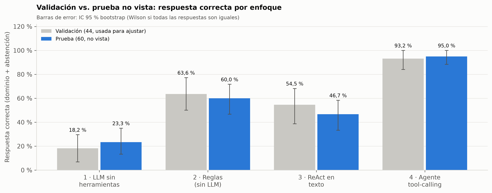
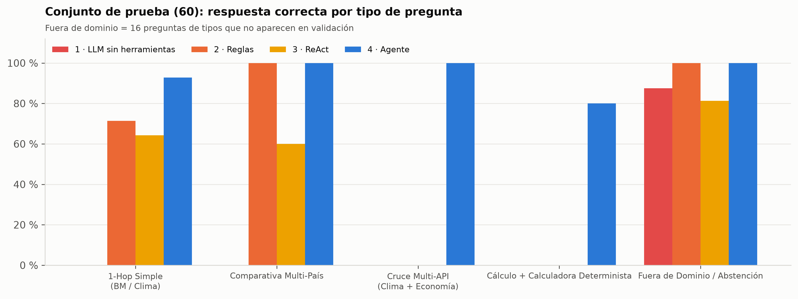
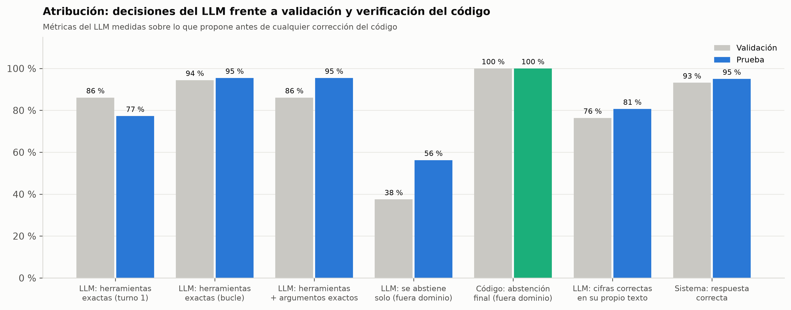
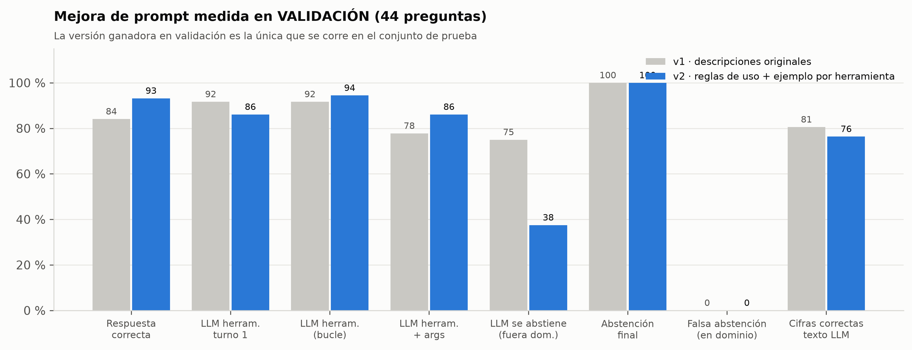
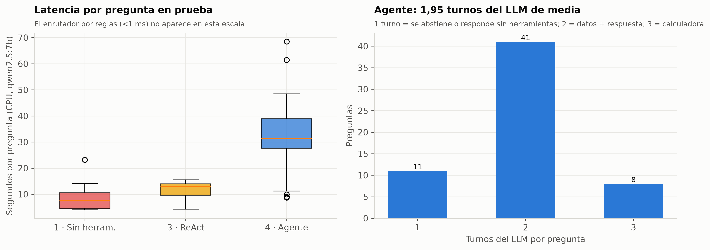
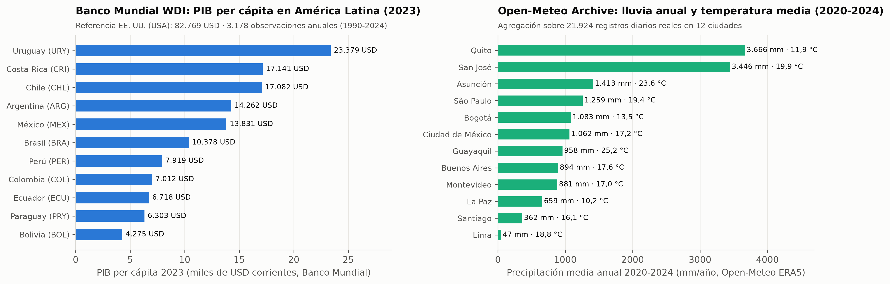
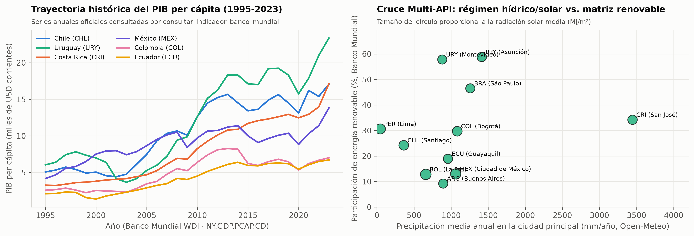
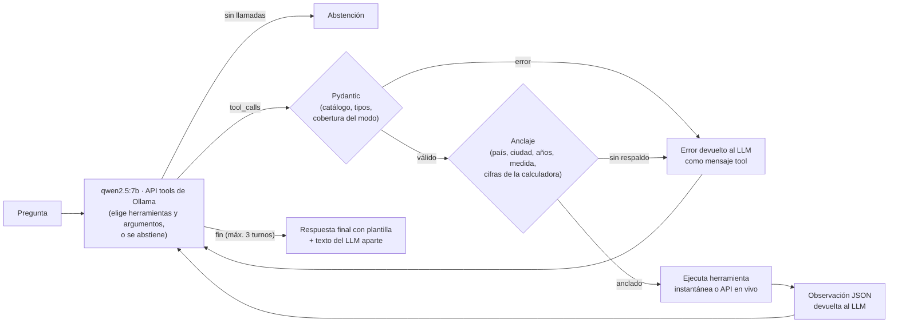

# 🌐 Agente de datos abiertos con herramientas: Banco Mundial + Open-Meteo

Un LLM local (`qwen2.5:7b` en Ollama, CPU) responde preguntas sobre economía y clima de América Latina **llamando a 5 herramientas** conectadas al Banco Mundial (WDI) y a Open-Meteo (ERA5). El proyecto mide por separado **lo que decide el LLM** (qué herramienta, con qué argumentos, cuándo abstenerse) y **lo que hace el código** (validar, verificar, ejecutar y redactar), en un conjunto de **validación** (44 preguntas, usado para ajustar) y uno de **prueba nuevo** (60 preguntas, corrido una sola vez).


---

## 📌 Resumen en cifras

| | Validación (44) | **Prueba no vista (60)** |
|---|---:|---:|
| Respuesta correcta del agente (IC 95 %) | 93,2 % (0,84–1,00) | **95,0 % (0,88–1,00)** |
| El LLM elige herramientas exactas (preguntas en dominio) | 94,4 % | 95,5 % |
| El LLM elige herramientas **y** argumentos exactos | 86,1 % | 95,5 % |
| Abstención correcta fuera de dominio (IC 95 % Wilson) | 100,0 % (0,68–1,00) | 100,0 % (0,81–1,00) |
| … de ellas, el LLM se abstuvo **solo**, sin el código | 37,5 % | 56,2 % |
| Turnos del LLM por pregunta (media) | 2,11 | 1,95 |
| Latencia media por pregunta (CPU) | 49,2 s | 31,6 s |

Líneas base en prueba: LLM sin herramientas **23,3 %**, enrutador por reglas **60,0 %**, ReAct en texto **46,7 %**.

---

## 🛠️ Decisiones de diseño y errores que corregí

Medir un agente con herramientas es fácil de hacer mal. Estos son los errores de diseño que encontré en una revisión y cómo quedaron resueltos:

1. **Sobreajuste al benchmark.** Un «guardrail» de dominio hecho con una lista de regex con las palabras literales de las preguntas trampa (`bitcoin`, `nasdaq`, `marte`, `camas de hospital`, `tokio`…) da un número alto que no dice nada. Aquí no hay listas de temas: el LLM decide si llamar herramientas y el código aplica reglas **derivadas de las capacidades** de las herramientas (catálogo, cobertura y anclaje de cada argumento). Una prueba automática verifica que esas palabras no estén en el motor.
2. **El código no debe sobrescribir al LLM.** Si los argumentos del modelo se reemplazan por los que extrae una regex, y el código añade por su cuenta la segunda API y la calculadora, lo que se mide es el código y la ablación lo delata (añadir Pydantic no mueve nada y todo el salto viene del encadenamiento fijo). Aquí se ejecuta **lo que propone el LLM**; si un argumento es inválido, el error vuelve al LLM para que lo corrija en el turno siguiente.
3. **Fidelidad tautológica.** La respuesta final sale de una plantilla (`sintetizar_respuesta_verificada`), así que su fidelidad es por construcción y **no se presenta como mérito del modelo**. Lo que sí se mide es la fidelidad del texto que redacta el LLM (abajo).
4. **Validación y prueba separadas.** Las 44 preguntas de **validación** sirven para ajustar todo (reglas, elección del prompt). El conjunto de **prueba** (60 preguntas con otros países, años, ciudades y redacciones, y 16 fuera de dominio de tipos distintos: población, pobreza, Venezuela, Toronto, pronóstico de mañana, PM2.5, elecciones…) se corre una sola vez.
5. **Cifras que salen de los datos.** Todas las cifras de ejemplo salen de la instantánea: **5.463,65 USD (2020)**, **6.718,14 USD (2023)**, **5.976,16 USD (2015)** de PIB per cápita de Ecuador. Una prueba comprueba que cifras que no existen en los datos no aparezcan en la guía.
6. **APIs en vivo.** Hay un cliente HTTP real con caché, pausas y reintentos, y dos modos (`instantanea` y `vivo`).
7. **Pregunta de validación con verdad vacía.** V25 pedía energía renovable de Brasil en 2022, año sin dato de `EG.FEC.RNEW.ZS` en WDI; se corrigió a 2021.

---

## 🏆 Resultados

### 1. Validación frente a prueba no vista

Respuesta correcta = en dominio, la respuesta final contiene todas las cifras de referencia (error ≤ 1 %) sin abstenerse; fuera de dominio, se abstiene sin ejecutar ninguna herramienta. IC 95 %: bootstrap percentil con 2.000 remuestreos; cuando todas las respuestas son iguales (bootstrap degenerado), Wilson (marcado «W»).

| Enfoque | Conjunto | Respuesta correcta (IC 95 %) | En dominio | Abstención fuera de dominio | Falsa abstención en dominio | Turnos LLM | Latencia media |
|---|---|---:|---:|---:|---:|---:|---:|
| 1 · LLM sin herramientas | Validación (44) | 18,2 % (0,07–0,30) | 0,0 % | 100,0 % (0,68–1,00 W) | 33,3 % | 1,00 | 8,9 s |
|  | **Prueba (60)** | 23,3 % (0,13–0,35) | 0,0 % | 87,5 % (0,69–1,00) | 52,3 % | 1,00 | 8,0 s |
| 2 · Enrutador por reglas (sin LLM) | Validación (44) | 63,6 % (0,50–0,77) | 55,6 % | 100,0 % (0,68–1,00 W) | 0,0 % | 0,00 | < 1 ms |
|  | **Prueba (60)** | 60,0 % (0,47–0,72) | 45,5 % | 100,0 % (0,81–1,00 W) | 6,8 % | 0,00 | < 1 ms |
| 3 · ReAct en texto (LLM, 1 turno) | Validación (44) | 54,5 % (0,39–0,68) | 44,4 % | 100,0 % (0,68–1,00 W) | 36,1 % | 1,00 | 10,8 s |
|  | **Prueba (60)** | 46,7 % (0,33–0,58) | 34,1 % | 81,2 % (0,62–1,00) | 40,9 % | 1,00 | 11,7 s |
| **4 · Agente tool-calling (prompt v2)** | Validación (44) | 93,2 % (0,84–1,00) | 91,7 % | 100,0 % (0,68–1,00 W) | 0,0 % | 2,11 | 49,2 s |
|  | **Prueba (60)** | **95,0 % (0,88–1,00)** | 93,2 % | 100,0 % (0,81–1,00 W) | 6,8 % | 1,95 | 31,6 s |

- El agente **no cae** en prueba (93,2 % → 95,0 %; los intervalos se solapan casi por completo, así que la diferencia no es significativa).
- El **enrutador por reglas sí muestra el sobreajuste**: sus regex se escribieron para las 44 de validación y en preguntas simples de prueba baja de 100 % a 71,4 %.
- El LLM sin herramientas **no acierta ninguna** pregunta en dominio en ningún conjunto e inventa cifras: de media cita 0,68 números por respuesta que no coinciden con el dato real. Fuera de dominio, en prueba responde de memoria a 2 de 16 («deuda pública de Argentina en 2022 … 395,1 mil millones»).

| Validación frente a prueba | Prueba por tipo de pregunta |
|---|---|
|  |  |

### 2. Qué hace el LLM y qué hace el código

Las métricas del LLM puntúan **lo que propone antes de cualquier intervención del código** (argumentos normalizados solo de formato por Pydantic, p. ej. `"Perú"→"PER"`). Preguntas en dominio: 36 en validación y 44 en prueba.

| Enfoque | Conjunto | Herramientas exactas, turno 1 | Herramientas exactas (todos los turnos) (IC 95 %) | Herramientas + argumentos exactos (IC 95 %) | Exactitud media de argumentos | LLM se abstiene solo fuera de dominio |
|---|---|---:|---:|---:|---:|---:|
| 3 · ReAct en texto | Validación | 44,4 % | 44,4 % (0,28–0,61) | 44,4 % (0,28–0,61) | 52,8 % | 100,0 % |
| 3 · ReAct en texto | **Prueba** | 36,4 % | 36,4 % (0,23–0,50) | 34,1 % (0,20–0,48) | 45,3 % | 81,2 % |
| 4 · Agente · prompt v1 | Validación | 91,7 % | 91,7 % (0,81–1,00) | 77,8 % (0,61–0,92) | 91,0 % | 75,0 % |
| 4 · Agente · prompt v2 | Validación | 86,1 % | 94,4 % (0,86–1,00) | 86,1 % (0,75–0,97) | 97,9 % | 37,5 % |
| 4 · Agente · prompt v2 | **Prueba** | 77,3 % | 95,5 % (0,89–1,00) | 95,5 % (0,89–1,00) | 95,5 % | 56,2 % |

«Turno 1» castiga por diseño las preguntas de cálculo: con v2 el LLM consulta los datos en el turno 1 y llama a la calculadora en el turno 2, que es lo correcto.

| Quién | Etapa | Validación | Prueba |
|---|---|---:|---:|
| LLM | Elige la combinación exacta de herramientas (todos los turnos) | 94,4 % | 95,5 % |
| LLM | Herramientas y argumentos exactos (año, país, ciudad, cifras) | 86,1 % | 95,5 % |
| LLM | Se abstiene solo (no llama herramientas) fuera de dominio | 37,5 % | 56,2 % |
| LLM | Fidelidad numérica del texto que redacta el LLM | 76,4 % | 80,7 % |
| Código | Abstención final fuera de dominio (tras Pydantic + anclaje) | 100,0 % | 100,0 % |
| Código | Falsa abstención en dominio (anclaje/validación demasiado estrictos) | 0,0 % | 6,8 % |
| Código | Fidelidad de la respuesta final (plantilla: por construcción) | 97,2 % | 93,2 % |
| Sistema | Respuesta correcta (todas las preguntas) | 93,2 % | 95,0 % |

Cómo leerla:
- **La selección de herramientas y argumentos es mérito del LLM** (95,5 % en prueba): el código ya no completa ni reescribe llamadas.
- **La abstención es sobre todo mérito del código.** En prueba el LLM se abstuvo solo en 9 de 16 preguntas fuera de dominio; en las otras 7 intentó una llamada (país `VEN`, ciudad «Cuenca» o «Toronto», variable «humedad», indicador «deuda», clima de 2010…) que **Pydantic rechazó** por estar fuera del catálogo o de la cobertura. El LLM leyó el error y se abstuvo. Ninguna pregunta fuera de dominio ejecutó una herramienta.
- **La verificación de anclaje** frenó en validación tres llamadas a la calculadora con cifras **inventadas** (el LLM la llamó en el mismo turno que la consulta, antes de ver los datos). Pero también produce **falsas abstenciones**: en prueba, «¿Qué porcentaje de los mexicanos usaba internet en 2020?» no nombra a México y el anclaje rechazó `MEX`.
- **Si el LLM redactara la respuesta**, solo el 80,7 % de las cifras de referencia aparecerían correctas en su texto (en prueba). Por eso la respuesta final se arma con plantilla; el texto del LLM se muestra aparte en la API y en la app.



### 3. Mejora de prompt medida en validación

v1 = descripciones originales de las herramientas. v2 = cada descripción añade cuándo usarla, el formato de los argumentos y un ejemplo inventado (valores que no salen del benchmark), y el prompt del sistema añade 4 reglas de proceso (comparar en una sola llamada, cruzar las dos APIs en el mismo turno, calculadora en el turno siguiente con los valores observados, corregir o abstenerse ante un error). La regla de elección se fijó antes: gana la de más respuestas correctas en validación. Solo la ganadora (v2) se corrió en prueba.

| Métrica (validación, 44) | v1 | v2 | Efecto |
|---|---:|---:|---:|
| Respuesta correcta | 84,1 % | 93,2 % | +9,1 pp |
| LLM: herramientas exactas (todos los turnos) | 91,7 % | 94,4 % | +2,8 pp |
| LLM: herramientas + argumentos exactos | 77,8 % | 86,1 % | +8,3 pp |
| LLM: herramientas exactas en el turno 1 | 91,7 % | 86,1 % | −5,6 pp |
| LLM: se abstiene solo fuera de dominio | 75,0 % | 37,5 % | −37,5 pp |
| Abstención final fuera de dominio | 100,0 % | 100,0 % | 0,0 pp |
| Fidelidad del texto del LLM | 80,6 % | 76,4 % | −4,2 pp |
| Turnos del LLM por pregunta | 1,89 | 2,11 | +0,22 |
| Latencia media | 36,1 s | 49,2 s | +13,2 s |

Con v1 el LLM fallaba sobre todo en cálculo (pasaba mal los argumentos de la calculadora o no la llamaba: 7 errores). v2 corrige la mayoría, pero vuelve al LLM **más propenso a intentar una llamada** fuera de dominio (75,0 % → 37,5 % de abstención propia); esas llamadas las frena Pydantic. Es un intercambio real: v2 depende más de la validación del código.



### 4. Errores del agente en prueba (3 de 60)

| Pregunta | Qué pasó | Responsable |
|---|---|---|
| T06 «¿Qué porcentaje de los mexicanos usaba internet en 2020?» | El LLM pidió `MEX` correctamente; el anclaje lo rechazó porque «mexicanos» no es un alias de país | Código (falsa abstención) |
| T36 «Variación porcentual de la esperanza de vida de Bolivia de 2000 a 2020» | El LLM se abstuvo diciendo que 2000 está «fuera del rango 1990-2024» | LLM |
| T42 «Variación porcentual de la energía renovable en Chile entre 2000 y 2020» | Mismo error de razonamiento sobre el rango de años | LLM |

En validación, los 3 errores fueron llamadas a la calculadora con cifras inventadas que el anclaje bloqueó y que el LLM no reintentó.

### 5. Costo: latencia y turnos

El agente hace **1,95 turnos del LLM por pregunta** en prueba (2,14 en las de dominio): 1 si se abstiene, 2 para datos + respuesta, 3 cuando usa la calculadora. Cada turno envía unos 1.500 tokens de prompt (esquemas de 5 herramientas), así que en CPU la latencia es el principal costo: **31,6 s de media** en prueba (mediana 31,4 s, p90 44,2 s) frente a **8,0 s** del LLM sin herramientas y **< 1 ms** del enrutador por reglas. La validación midió 49,2 s porque se corrió mientras otro proyecto local usaba el mismo Ollama. Para tráfico real haría falta GPU, o reservar el agente para las preguntas compuestas y resolver las simples con reglas + validación.



---

## 🌍 Datos y APIs: modo instantánea y modo vivo

| Modo | De dónde leen las herramientas | Cobertura | Uso |
|---|---|---|---|
| `instantanea` (por defecto) | `data/instantanea_indicadores.json` (3.178 observaciones WDI) y `data/instantanea_clima.json` (21.924 días-ciudad) | Banco Mundial 1990–2024 · clima **2020–2024** | evaluación reproducible, pruebas, demo sin red |
| `vivo` (`AGENTE_MODO_DATOS=vivo`) | `api.worldbank.org/v2` y `archive-api.open-meteo.com/v1/archive` vía `src/agente/clientes_api.py` | Banco Mundial 1960–2024 · clima **desde 1940** | datos actuales y años fuera de la instantánea |

- **La ventana 2020–2024 del clima es una decisión de diseño de la instantánea**, no un límite de Open-Meteo, cuyo archivo ERA5 llega a 1940. En modo vivo, «¿Cuál fue la precipitación acumulada en Quito entre 1995-01-01 y 1995-12-31?» se responde (**2.860,4 mm**), mientras que en modo instantánea el agente se abstiene porque Pydantic rechaza la fecha (`reports/prueba_modo_vivo.json`, 5 preguntas en ambos modos).
- **Cliente HTTP:** caché en disco (`data/cache_api/`, clave SHA-1 de URL + parámetros), mínimo 1 s entre peticiones y hasta 4 reintentos con espera exponencial ante `429`/`5xx` (respeta `Retry-After`). El día de la prueba, la API del Banco Mundial tardó unos 30 s por petición: sin la caché, el modo vivo sería inutilizable.
- **Verdad terreno verificada contra las APIs:** las 98 llamadas de datos distintas de validación y prueba se re-ejecutaron en modo vivo y **las 98 coinciden** con la instantánea (diferencia ≤ 0,5 %; `reports/verificacion_verdad_terreno_vivo.csv`). Las series de Open-Meteo pueden variar unas décimas: la lluvia de Guayaquil en 2023 da 1.559,2 mm en la instantánea y 1.558,5 mm en vivo.

| Cobertura de los datos | Cruce clima + economía |
|---|---|
|  |  |

---

## 🧠 Arquitectura



| Componente | Lo hace | Archivo |
|---|---|---|
| Elegir herramienta, argumentos, abstenerse, pedir otro turno | **LLM** | `motor_agente.ejecutar_agente_herramientas` |
| Normalizar alias y rechazar valores fuera de catálogo o cobertura | Código (Pydantic) | `herramientas.py` |
| Rechazar argumentos sin respaldo en la pregunta | Código (`verificar_anclaje`) | `motor_agente.py`, vocabulario en `config.TERMINOS_*` |
| Calcular variaciones, diferencias, correlaciones | Código (calculadora, a pedido del LLM) | `herramientas.calcular_correlacion_o_cambio` |
| Redactar la respuesta final | Código (plantilla) | `motor_agente.sintetizar_respuesta_verificada` |

---

## 🖥️ App Streamlit y API

```bash
streamlit run app/app_streamlit.py
```

La app muestra la respuesta final, el texto propio del LLM y **el rastro de cada turno**: herramientas pedidas, argumentos que propuso el LLM, argumentos validados, rechazos con su motivo y las observaciones JSON. Las 104 preguntas de evaluación funcionan sin Ollama; una pregunta nueva necesita `ollama serve`. Permite elegir modo `instantanea` o `vivo`.

```bash
uvicorn api.main:app --reload          # http://localhost:8000/docs
```

`POST /consultar` (con `modo_datos`) devuelve también `rastro_pasos_llm` y `texto_llm`; `POST /evaluar_traza` audita si las cifras de una respuesta externa salen de las herramientas.

---

## 🚀 Cómo ejecutarlo

Guía para Windows y 10 preguntas de entrevista: **[docs/GUIA_PASO_A_PASO.md](docs/GUIA_PASO_A_PASO.md)** · Ficha técnica: **[MODEL_CARD.md](MODEL_CARD.md)**

```powershell
pip install -r requirements.txt; pip install -e .
pytest -q                                    # 20 pruebas, sin Ollama ni red
python -m agente.ejecutar_evaluacion         # reproduce reports/ desde las grabaciones (~1 min)
```

Para volver a consultar el LLM (horas en CPU, reanudable): `cd src; python -m agente.correr_llm validacion`, luego `prueba_agente` y `prueba_base`.

---

## 📁 Estructura

```text
├── app/app_streamlit.py          app con el rastro de herramientas
├── api/main.py                   FastAPI (/health, /herramientas, /consultar, /evaluar_traza)
├── data/
│   ├── instantanea_*.json        instantáneas del Banco Mundial y Open-Meteo
│   ├── conjunto_validacion.json  44 preguntas (V01-V44) con verdad terreno
│   ├── conjunto_prueba.json      60 preguntas nuevas (T01-T60) con verdad terreno
│   └── grabacion_llm.jsonl       512 respuestas de qwen2.5:7b (huella SHA-1 del prompt)
├── src/agente/
│   ├── config.py                 catálogo, vocabulario de capacidades, modos y cobertura
│   ├── clientes_api.py           cliente HTTP con caché, pausas y reintentos
│   ├── datos.py                  instantáneas y fuente de datos según el modo
│   ├── herramientas.py           5 herramientas + Pydantic + descripciones v1/v2
│   ├── motor_agente.py           4 enfoques; agente con bucle de tool-calling y anclaje
│   ├── conjuntos.py              conjunto de prueba (60)
│   ├── evaluacion.py             verdad terreno, métricas LLM/sistema, IC 95 %
│   ├── correr_llm.py             corre y graba las llamadas al LLM (reanudable)
│   ├── verificacion_vivo.py      verdad terreno y agente contra las APIs en vivo
│   ├── ejecutar_evaluacion.py    pipeline de evaluación, tablas y figuras
│   └── graficos.py               7 figuras PNG
├── notebooks/                    ingesta, arquitectura y evaluación (ejecutados)
├── reports/                      CSV, resultados.json y figuras
└── tests/test_agente.py          20 pruebas
```

---

## ⚖️ Limitaciones

- **Conjuntos pequeños y escritos por el mismo autor.** Con 60 preguntas, el IC del agente en prueba va de 0,88 a 1,00. El conjunto de prueba se redactó después de congelar el código, pero no lo escribieron anotadores independientes.
- **El vocabulario de anclaje es manual** (`config.TERMINOS_*`): describe qué mide cada herramienta, pero un sinónimo no previsto o un gentilicio («mexicanos») produce falsas abstenciones (6,8 % en prueba).
- **Las líneas base** zero-shot y ReAct de validación reutilizan grabaciones de una corrida previa con los mismos prompts (solo V25 se grabó de nuevo); las de prueba se grabaron con el mismo prompt y `num_ctx=2048`.
- **Cálculo, el punto débil del LLM:** 62,5 % en validación y 80,0 % en prueba. Los fallos son razonamiento del modelo (llamar a la calculadora antes de ver los datos, creer que el año 2000 está fuera de 1990–2024), no del código.
- **Las cifras son las de la instantánea** descargada el 22-10-2026; el Banco Mundial revisa series y Open-Meteo puede variar décimas.

---

## 📚 Fuentes

- **World Development Indicators** — Banco Mundial, API v2 (CC BY 4.0): <https://api.worldbank.org/v2/> · <https://datahelpdesk.worldbank.org/knowledgebase/articles/889392>
- **Open-Meteo Historical Weather API** — reanálisis ERA5 / Copernicus (datos CC BY 4.0, con atribución): <https://open-meteo.com/en/docs/historical-weather-api>. **Condición de uso de la API:** el acceso gratuito de Open-Meteo es **solo para uso no comercial** (este proyecto es un portafolio educativo); un uso comercial requiere su plan de pago o su propio servidor. La licencia CC BY de los datos no cambia esa condición del servicio. Modo `instantanea` (evaluación y pruebas) no llama a la API; el modo `vivo` sí, con caché y pausas para respetar sus límites.

## 📜 Licencia

El **código** es MIT (ver [`LICENSE`](LICENSE)). Los **datos** siguen su propia licencia: Banco Mundial WDI (CC BY 4.0) y Open-Meteo / ERA5 (CC BY 4.0, API gratuita solo para uso no comercial), como se indica en *Fuentes*.

---

**Erick Guarnizo** · proyecto de portafolio (agentes con herramientas, LLM local y datos abiertos)
