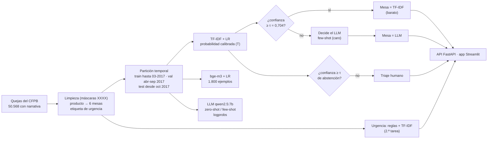
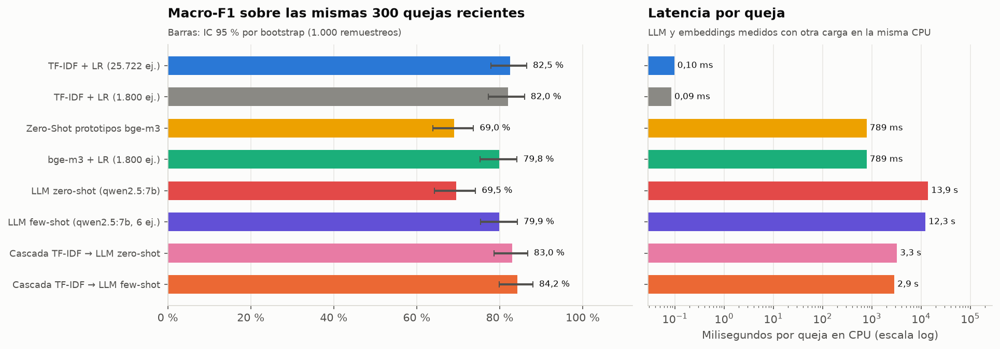
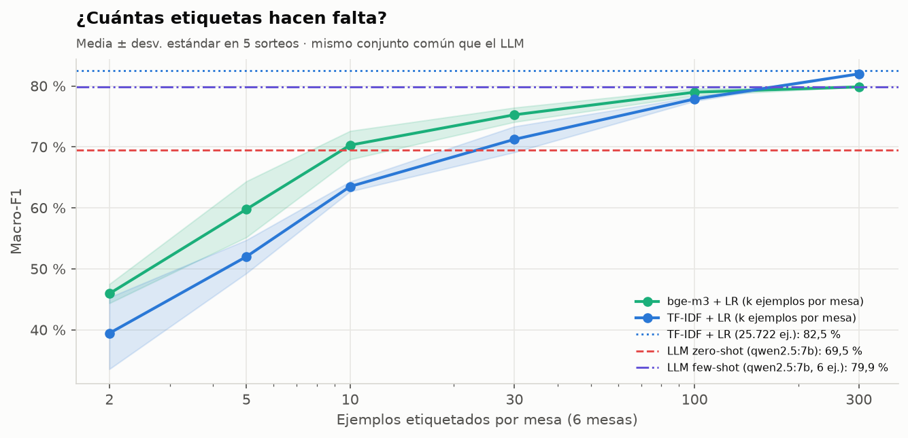
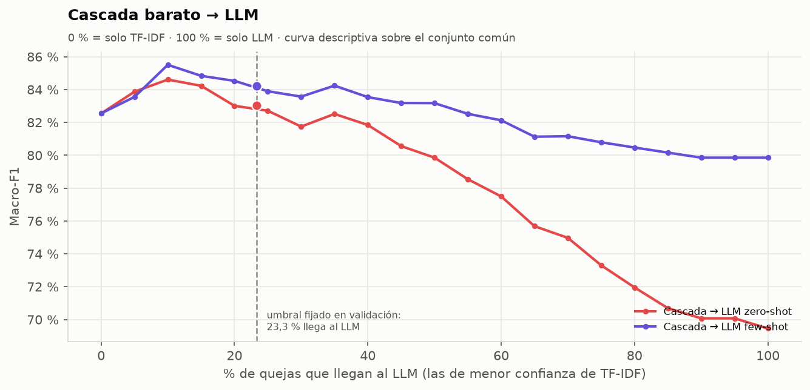
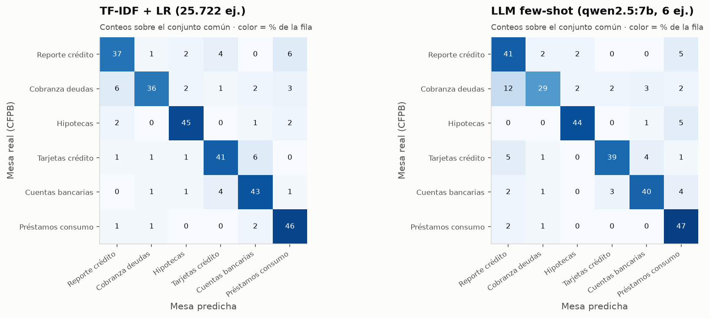
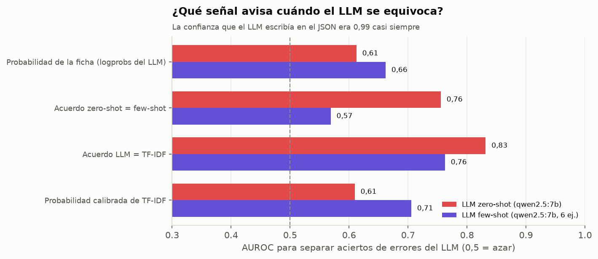
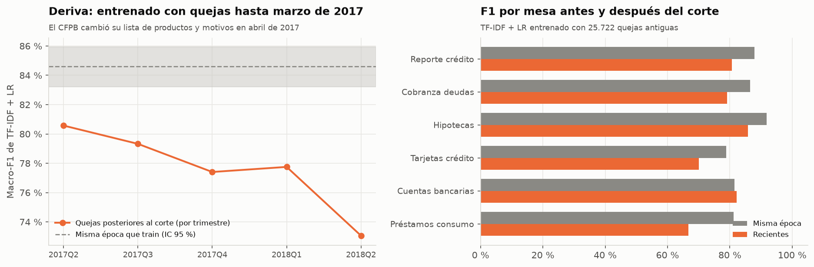
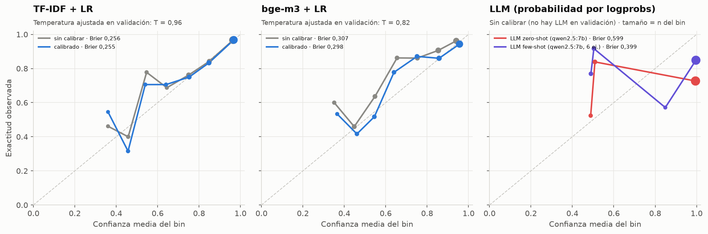
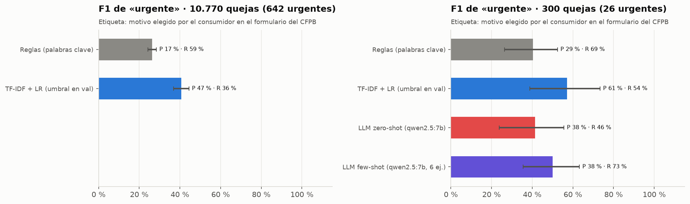
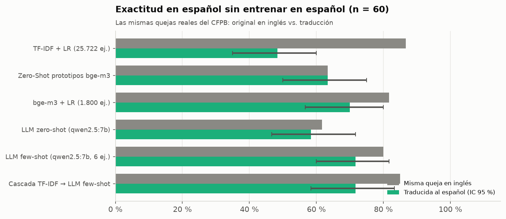

# 📨 Enrutamiento de quejas financieras: TF-IDF vs. embeddings vs. LLM, cascada y urgencia

<!-- Archivo generado por `python -m quejas.informe` desde scripts/plantillas/README.md: todas las cifras salen de reports/resultados.json. -->

¿Hace falta un **LLM local** para enrutar quejas financieras a la mesa correcta, o basta un **TF-IDF + regresión
logística**? Este proyecto lo mide con **50.568 quejas reales del CFPB** (*Consumer Financial Protection
Bureau*, EE. UU.; textos originales **en inglés**) con una **partición temporal** (entrenar con quejas antiguas, probar
con recientes), compara 5 enfoques y 2 cascadas **sobre las mismas 300 quejas**, detecta **urgencia**
(fraude, ejecución hipotecaria, reposesión, amenazas legales) y prueba la transferencia a **español**. Todo corre en
local y en CPU con Ollama (`qwen2.5:7b`, `bge-m3`), con API FastAPI y app Streamlit.


---

## 🎯 Conclusiones

1. **Sin ejemplos, el LLM pierde claramente; con 6 ejemplos queda al nivel de los clasificadores baratos, sin
   superarlos.** Sobre las mismas 300 quejas recientes: TF-IDF + LR **0,825** (IC 95 % 0,779–0,865),
   LLM zero-shot **0,695** (0,643–0,742), LLM few-shot **0,799** (0,754–0,842). Pasar de 0 a 6 ejemplos
   sube el Macro-F1 en +0,104 (IC pareado 0,059 a 0,152). La ventaja de TF-IDF sobre el few-shot
   (+0,027, IC -0,022 a 0,075) es **no distinguible** con 300 quejas: no se puede decir cuál es
   mejor, sí que TF-IDF tarda 0,10 ms por queja y el LLM 12,3 s.
2. **Por qué falla el zero-shot (matriz de confusión):** manda a «reporte de crédito» quejas que el CFPB archivó en otra
   mesa: Cobranza de deudas → Reporte y burós de crédito (19 quejas, 20 % de sus errores); Tarjetas de crédito y prepago → Reporte y burós de crédito (16 quejas, 17 % de sus errores); Tarjetas de crédito y prepago → Cuentas bancarias y transferencias (6 quejas, 6 % de sus errores). Las quejas de cobranza y de tarjetas suelen mencionar el reporte de crédito, pero la
   etiqueta del CFPB sigue al producto que eligió el consumidor. Con 6 ejemplos ese sesgo baja, aunque cobranza →
   reporte sigue siendo su error más frecuente.
3. **La cascada no empeora nada y quizá ayuda un poco, pero no está demostrado.** Con el umbral fijado en validación
   llega al LLM el 23,3 % de las quejas; la cascada con few-shot logra 0,842 (0,799–0,880) frente a
   0,825 de TF-IDF solo: +0,017 (IC -0,018 a 0,051, no distinguible), con
   ~2,9 s de latencia media. Con zero-shot: 0,830 (no distinguible de TF-IDF).
4. **La deriva temporal es real y medible:** el mismo TF-IDF baja de 0,846 (misma época que el
   entrenamiento) a 0,774 en quejas recientes (diferencia -0,072, IC -0,087 a -0,056). Una
   partición aleatoria habría sobreestimado el desempeño en producción.
5. **Con pocas etiquetas, embeddings; con cientos, TF-IDF alcanza.** Con 10 ejemplos por mesa, bge-m3 + LR da
   0,703 y TF-IDF 0,635; con 300 por mesa, 0,798 vs. 0,820. TF-IDF con las 25.722 quejas
   (0,825) apenas mejora sobre TF-IDF con 1.800 (0,820): en quejas recientes el límite lo pone la
   deriva y la ambigüedad de las etiquetas, no la cantidad de datos.
6. **Urgencia: ningún detector es bueno todavía.** En las 10.770 quejas recientes, TF-IDF + LR logra F1
   0,407 (precisión 46,8 %, exhaustividad 36,0 %) y las reglas
   0,263. En el conjunto común solo hay 26 urgentes: las diferencias entre TF-IDF, reglas y
   LLM caben dentro de sus intervalos.
7. **Español:** en 60 quejas reales traducidas, TF-IDF cae de 52 a 29 aciertos
   (su vocabulario es inglés); bge-m3 + LR pasa de 49 a 42 y el LLM few-shot de
   48 a 43. Con 60 quejas, bge-m3 + LR y el LLM few-shot no se distinguen entre sí;
   lo claro es que para quejas en español no sirve el TF-IDF entrenado en inglés.

---

## 🧠 Arquitectura



El umbral de la cascada, la temperatura de calibración, el de abstención y el de urgencia se eligen en **validación**
y se reportan en **prueba**; cada pieza se evalúa por separado sobre las mismas quejas.

---

## 📌 El problema y los datos

Una entidad financiera recibe quejas en texto libre que deben llegar a una de **6 mesas**. Las mesas son una
**agrupación propia** de los productos del CFPB (no una taxonomía oficial):

| Producto del CFPB | Mesa (agrupación propia) | Filas en el Parquet |
| --- | --- | ---: |
| `Credit reporting, credit repair services, or other personal consumer reports` | Reporte y burós de crédito | 12.335 |
| `Credit reporting` | Reporte y burós de crédito | 7.947 |
| `Debt collection` | Cobranza de deudas | 15.611 |
| `Mortgage` | Hipotecas y préstamos de vivienda | 11.014 |
| `Credit card` | Tarjetas de crédito y prepago | 4.650 |
| `Credit card or prepaid card` | Tarjetas de crédito y prepago | 2.698 |
| `Prepaid card` | Tarjetas de crédito y prepago | 346 |
| `Bank account or service` | Cuentas bancarias y transferencias | 3.707 |
| `Checking or savings account` | Cuentas bancarias y transferencias | 1.696 |
| `Money transfer, virtual currency, or money service` | Cuentas bancarias y transferencias | 744 |
| `Money transfers` | Cuentas bancarias y transferencias | 388 |
| `Student loan` | Préstamos estudiantiles, auto y consumo | 4.231 |
| `Consumer Loan` | Préstamos estudiantiles, auto y consumo | 2.358 |
| `Vehicle loan or lease` | Préstamos estudiantiles, auto y consumo | 659 |
| `Payday loan, title loan, or personal loan` | Préstamos estudiantiles, auto y consumo | 509 |
| `Payday loan` | Préstamos estudiantiles, auto y consumo | 445 |
| `Other financial service` | *(excluido)* | 72 |
| `Virtual currency` | *(excluido)* | 6 |

- **Origen:** espejo Parquet público del CFPB (69.416 filas). Se conservan 50.568 narrativas de 15 a
  260 palabras, sin duplicados, recibidas entre 2015-03-19 y 2018-04-25. El CFPB enmascara datos personales con
  `XXXX`; se eliminan antes de TF-IDF.
- **Partición temporal** (no aleatoria): las quejas se ordenan por fecha de recepción.

| Mesa | train | reserva misma época | val | test |
| --- | ---: | ---: | ---: | ---: |
| Reporte y burós de crédito | 5.481 | 663 | 5.066 | 4.747 |
| Cobranza de deudas | 6.955 | 805 | 2.339 | 2.436 |
| Hipotecas y préstamos de vivienda | 4.324 | 503 | 886 | 781 |
| Tarjetas de crédito y prepago | 3.131 | 343 | 936 | 995 |
| Cuentas bancarias y transferencias | 2.417 | 298 | 739 | 969 |
| Préstamos estudiantiles, auto y consumo | 3.414 | 388 | 1.110 | 842 |

- **train** (25.722): recibidas hasta el 31-03-2017, con la lista de productos antigua del CFPB.
- **reserva misma época** (3.000): sorteadas de ese mismo período; sirven para medir la deriva.
- **val** (11.076, abril–septiembre de 2017): **todos** los umbrales y la calibración se eligen aquí.
- **test** (10.770, desde octubre de 2017). Dentro de test, el **conjunto común**: 300 quejas
  balanceadas por mesa que evalúan **todos** los enfoques, incluido el LLM.
- `bge-m3 + LR` se entrena con 1.800 quejas (300 por mesa) del train porque cada embedding cuesta
  ~0,8 s en esta CPU (25.722 serían ~6 h); la curva de aprendizaje muestra cuánto se pierde por eso.

---

## 🏆 Resultados en el conjunto común (300 quejas recientes, balanceadas)

| Enfoque | Macro-F1 (IC 95 %) | Exactitud (IC 95 %) | Top-2 | Brier | Latencia CPU |
| --- | ---: | ---: | ---: | ---: | ---: |
| TF-IDF + LR (25.722 ej.) | **0,825** (0,779–0,865) | 82,7 % (78,3 %–86,7 %) | 93,3 % | 0,255 | 0,10 ms |
| TF-IDF + LR (1.800 ej.) | **0,820** (0,773–0,860) | 82,0 % (77,3 %–86,0 %) | 93,7 % | 0,284 | 0,09 ms |
| Zero-Shot prototipos bge-m3 | **0,690** (0,639–0,737) | 69,3 % (64,3 %–74,3 %) | 83,7 % | 0,532 | 789 ms |
| bge-m3 + LR (1.800 ej.) | **0,798** (0,752–0,842) | 80,0 % (75,7 %–84,7 %) | 90,0 % | 0,298 | 789 ms |
| LLM zero-shot (qwen2.5:7b) | **0,695** (0,643–0,742) | 69,0 % (63,7 %–74,0 %) | 84,3 % | 0,599 | 13,9 s |
| LLM few-shot (qwen2.5:7b, 6 ej.) | **0,799** (0,754–0,842) | 80,0 % (75,7 %–84,3 %) | 89,3 % | 0,399 | 12,3 s |
| Cascada TF-IDF → LLM zero-shot | **0,830** (0,787–0,867) | 83,0 % (78,7 %–87,0 %) | 90,7 % | 0,315 | 3,3 s |
| Cascada TF-IDF → LLM few-shot | **0,842** (0,799–0,880) | 84,3 % (80,3 %–88,3 %) | 91,7 % | 0,284 | 2,9 s |

IC 95 % por bootstrap (1.000 remuestreos de quejas). Brier multiclase: menor es mejor (0 = perfecto). Las
probabilidades del LLM salen de los **logprobs** de la primera ficha de la categoría. Latencias en una CPU sin GPU con
otro proceso usando Ollama al mismo tiempo: son órdenes de magnitud.

**Diferencias pareadas** (las mismas quejas en cada remuestreo; «no distinguible» = el IC incluye 0):

| Comparación (Macro-F1 A − B) | Diferencia | IC 95 % pareado | ¿Distinguible? |
| --- | ---: | ---: | ---: |
| TF-IDF + LR (25.722 ej.) − LLM zero-shot (qwen2.5:7b) | +0,131 | [0,072 a 0,190] | sí |
| TF-IDF + LR (25.722 ej.) − LLM few-shot (qwen2.5:7b, 6 ej.) | +0,027 | [-0,022 a 0,075] | **no** |
| LLM few-shot (qwen2.5:7b, 6 ej.) − LLM zero-shot (qwen2.5:7b) | +0,104 | [0,059 a 0,152] | sí |
| bge-m3 + LR (1.800 ej.) − LLM zero-shot (qwen2.5:7b) | +0,104 | [0,046 a 0,164] | sí |
| bge-m3 + LR (1.800 ej.) − LLM few-shot (qwen2.5:7b, 6 ej.) | −0,000 | [-0,047 a 0,046] | **no** |
| TF-IDF + LR (25.722 ej.) − bge-m3 + LR (1.800 ej.) | +0,027 | [-0,012 a 0,065] | **no** |
| bge-m3 + LR (1.800 ej.) − TF-IDF + LR (1.800 ej.) | −0,021 | [-0,063 a 0,021] | **no** |
| Cascada TF-IDF → LLM few-shot − TF-IDF + LR (25.722 ej.) | +0,017 | [-0,018 a 0,051] | **no** |
| Cascada TF-IDF → LLM zero-shot − TF-IDF + LR (25.722 ej.) | +0,005 | [-0,031 a 0,040] | **no** |
| TF-IDF + LR (25.722 ej.) − Zero-Shot prototipos bge-m3 | +0,136 | [0,079 a 0,189] | sí |

| Comparación de enfoques | Curva de aprendizaje |
|---|---|
|  |  |

| Ejemplos por mesa | Total | bge-m3 + LR | TF-IDF + LR |
| --- | ---: | ---: | ---: |
| 2 | 12 | 0,459 ± 0,016 | 0,394 ± 0,059 |
| 5 | 30 | 0,598 ± 0,046 | 0,520 ± 0,027 |
| 10 | 60 | 0,703 ± 0,023 | 0,635 ± 0,008 |
| 30 | 180 | 0,753 ± 0,012 | 0,712 ± 0,021 |
| 100 | 600 | 0,790 ± 0,006 | 0,778 ± 0,003 |
| 300 | 1.800 | 0,798 ± 0,000 | 0,820 ± 0,000 |

### Cascada barato → LLM

TF-IDF + LR decide cuando su probabilidad **calibrada** es ≥ 0,704; si no, decide el LLM. El umbral se fijó en
validación para que el 25 % de menor confianza vaya al LLM; en prueba llegó al LLM el 23,3 %.
La curva de abajo recorre todos los umbrales sobre el conjunto de prueba: sirve para ver la forma (el few-shot nunca
baja de TF-IDF solo hasta que recibe más de la mitad de las quejas; el zero-shot sí), no para elegir el punto, porque
elegirlo ahí sería ajustar con la prueba.



### ¿En qué se equivocan?



Confusiones más frecuentes del LLM zero-shot: Cobranza de deudas → Reporte y burós de crédito (19 quejas, 20 % de sus errores); Tarjetas de crédito y prepago → Reporte y burós de crédito (16 quejas, 17 % de sus errores); Tarjetas de crédito y prepago → Cuentas bancarias y transferencias (6 quejas, 6 % de sus errores). De TF-IDF: Reporte y burós de crédito → Préstamos estudiantiles, auto y consumo (6); Cobranza de deudas → Reporte y burós de crédito (6); Tarjetas de crédito y prepago → Cuentas bancarias y transferencias (6).

---

## 🧭 Confianza del LLM: por qué no se usa la que el LLM escribe

Se probó pedirle al LLM un campo `confianza` en el JSON: **53 de 54 respuestas decían 0,99**
(`data/experimento_confianza_autodeclarada.jsonl`), así que no servía para decidir nada. En su lugar se compararon
cuatro señales por su AUROC para separar aciertos de errores del LLM (0,5 = azar):

| Señal | AUROC (LLM zero-shot) | AUROC (LLM few-shot) |
| --- | ---: | ---: |
| Probabilidad de la ficha (logprobs del LLM) | 0,61 | 0,66 |
| Acuerdo zero-shot = few-shot | 0,76 | 0,57 |
| Acuerdo LLM = TF-IDF | 0,83 | 0,76 |
| Probabilidad calibrada de TF-IDF | 0,61 | 0,71 |



- La probabilidad de los **logprobs** del LLM sí varía (no es siempre 0,99), pero separa mal aciertos de errores
  (AUROC 0,61 en zero-shot y 0,66 en few-shot): el 66,3 % de las
  respuestas zero-shot tienen probabilidad ≥ 0,99, incluidas muchas equivocadas.
- La mejor alarma es el **desacuerdo con TF-IDF** (AUROC 0,83 / 0,76).
  El acuerdo entre zero-shot y few-shot ayuda para el zero-shot (0,76) pero casi nada para el
  few-shot (0,57): cuando discrepan (62 quejas), el few-shot acierta el
  69,4 %.
- **Por eso la cascada y la abstención usan la probabilidad calibrada del clasificador barato**: se calcula para
  todas las quejas antes de llamar al LLM, se calibra y se elige su umbral en validación sin gastar llamadas, y en
  prueba se comporta como dice (curva de confiabilidad cerca de la diagonal). Varias muestras del LLM costarían
  varias llamadas más por queja (y con temperatura 0 devolverían lo mismo).

---

## 📉 Deriva temporal

TF-IDF + LR entrenado con quejas hasta marzo de 2017: Macro-F1 **0,846** (0,832–0,859) en la
reserva de la misma época vs. **0,774** (0,765–0,783) en las 10.770 quejas desde
octubre de 2017. Diferencia -0,072 (IC 95 % -0,087 a -0,056). La caída coincide con el cambio de abril de
2017, cuando el CFPB renombró productos y motivos de su formulario (las mesas absorben los nombres nuevos); no separé
cuánto se debe a eso y cuánto a otros cambios (empresas, temas nuevos como las criptomonedas).



| Trimestre de recepción | Quejas | Macro-F1 | Exactitud |
| --- | ---: | ---: | ---: |
| 2017Q2 | 4.866 | 0,806 | 81,1 % |
| 2017Q3 | 6.210 | 0,793 | 81,6 % |
| 2017Q4 | 5.206 | 0,774 | 78,3 % |
| 2018Q1 | 5.054 | 0,778 | 78,6 % |
| 2018Q2 | 510 | 0,731 | 77,3 % |

| Mesa | F1 misma época | F1 recientes | Cambio |
| --- | ---: | ---: | ---: |
| Reporte y burós de crédito | 0,880 | 0,807 | −0,073 |
| Cobranza de deudas | 0,864 | 0,791 | −0,073 |
| Hipotecas y préstamos de vivienda | 0,918 | 0,858 | −0,060 |
| Tarjetas de crédito y prepago | 0,788 | 0,700 | −0,088 |
| Cuentas bancarias y transferencias | 0,815 | 0,822 | +0,007 |
| Préstamos estudiantiles, auto y consumo | 0,812 | 0,668 | −0,144 |

Nota: la reserva de la misma época tiene otra mezcla de mesas que las recientes (en 2018 crece «reporte de crédito»);
el Macro-F1 promedia por mesa y amortigua ese efecto, pero no lo elimina.

---

## 🎚️ Calibración, umbral de abstención y Brier

bge-m3 + LR (1.800 quejas de entrenamiento) tiene Brier 0,307 sin calibrar; su temperatura óptima
en validación es T = 0,82 (< 1: el modelo es **subconfiado**, su confianza media es 72,4 % con
80,0 % de exactitud) y al calibrar baja a 0,298 (ECE 0,079 → 0,046). Un
clasificador lineal regularizado entrenado con pocas quejas tiende a aplanar sus probabilidades. TF-IDF ya está calibrado (T = 0,96, Brier
0,256 → 0,255).
El LLM no se puede calibrar sin gastar llamadas en validación: su Brier es 0,599 (zero-shot) y
0,399 (few-shot) y es sobreconfiado.



**Abstención a triaje humano.** Con 14 USD por queja mal enrutada y 3,50 USD por revisarla a mano, el umbral de mínimo
costo se eligió en validación y se aplicó en prueba: para TF-IDF + LR, τ = 0,75 automatiza el
72,3 % de las quejas con 91,7 % de exactitud (sin abstención: 82,7 %) y
ahorra el 25,5 % del costo. Para bge-m3 + LR, τ = 0,78: 60,3 % automatizado,
91,7 % de exactitud, ahorro 25,4 %.

---

## 🚨 Segunda tarea: urgencia

«Urgente» = el consumidor eligió en el formulario del CFPB un motivo de fraude o robo de identidad, riesgo de
ejecución hipotecaria (incluye «Loan modification, collection, foreclosure» y «Struggling to pay mortgage»),
reposesión del vehículo, o amenazas de arresto, embargo o demanda sin aviso (7,6 % del corpus). La
etiqueta no sale del texto, así que mide a los detectores de forma independiente, pero es ruidosa.

| Detector | Conjunto | Quejas (urgentes) | Precisión | Exhaustividad (IC 95 %) | F1 (IC 95 %) | PR-AUC |
| --- | --- | ---: | ---: | ---: | ---: | ---: |
| Reglas (palabras clave) | reciente completo | 10.770 (642) | 16,9 % | 59,3 % (55 %–63 %) | **0,263** (0,242–0,284) | — |
| TF-IDF + LR (umbral en val) | reciente completo | 10.770 (642) | 46,8 % | 36,0 % (32 %–40 %) | **0,407** (0,369–0,444) | 0,411 |
| Reglas (palabras clave) | común | 300 (26) | 28,6 % | 69,2 % (50 %–87 %) | **0,404** (0,264–0,524) | — |
| TF-IDF + LR (umbral en val) | común | 300 (26) | 60,9 % | 53,8 % (35 %–75 %) | **0,571** (0,389–0,733) | 0,556 |
| LLM zero-shot (qwen2.5:7b) | común | 300 (26) | 37,5 % | 46,2 % (26 %–66 %) | **0,414** (0,238–0,556) | 0,273 |
| LLM few-shot (qwen2.5:7b, 6 ej.) | común | 300 (26) | 38,0 % | 73,1 % (55 %–89 %) | **0,500** (0,355–0,632) | 0,386 |



| Tipo (motivo CFPB) | Quejas urgentes en test | Exhaustividad TF-IDF | Exhaustividad reglas |
| --- | ---: | ---: | ---: |
| Amenaza legal / embargo | 74 | 18,9 % | 60,8 % |
| Ejecución hipotecaria / modificación | 220 | 65,9 % | 58,2 % |
| Fraude / robo de identidad | 311 | 23,2 % | 59,8 % |
| Reposesión de vehículo | 37 | 0,0 % | 59,5 % |

Por tipo (tabla anterior): las reglas encuentran más casos de fraude, reposesión y amenazas legales, a costa de
marcar muchas quejas que no son urgentes; TF-IDF es más preciso y encuentra más casos de ejecución hipotecaria (el
tipo más frecuente en el entrenamiento), pero se le escapan los tipos minoritarios. Para producción convendría
combinar ambos (marcar si cualquiera lo marca) y revisar a mano una muestra de la etiqueta, que es un proxy ruidoso.

---

## 🌎 Español

Las 60 quejas en español son **traducciones de quejas reales** del conjunto común (las primeras ~80
palabras), con su etiqueta del CFPB, hechas con Claude (un modelo distinto de qwen2.5:7b, para no favorecerlo) y sin
revisión de un traductor profesional. Se eligieron traducciones de quejas reales y no textos redactados por una IA,
que serían más limpios y fáciles. Ningún modelo vio español al entrenar.

| Enfoque (sin entrenar en español) | Aciertos en inglés | Aciertos en español | Exactitud en español (IC 95 %) |
| --- | ---: | ---: | ---: |
| TF-IDF + LR (25.722 ej.) | 52/60 | 29/60 | 48,3 % (35 %–60 %) |
| Zero-Shot prototipos bge-m3 | 38/60 | 38/60 | 63,3 % (50 %–75 %) |
| bge-m3 + LR (1.800 ej.) | 49/60 | 42/60 | 70,0 % (57 %–80 %) |
| LLM zero-shot (qwen2.5:7b) | 37/60 | 35/60 | 58,3 % (47 %–72 %) |
| LLM few-shot (qwen2.5:7b, 6 ej.) | 48/60 | 43/60 | 71,7 % (60 %–82 %) |
| Cascada TF-IDF → LLM few-shot | 51/60 | 43/60 | 71,7 % (58 %–83 %) |



- **TF-IDF** acierta 29 de 60 en español frente a 52 con las mismas quejas en
  inglés: su vocabulario se aprendió en inglés y casi no se comparte con el español.
- **bge-m3 + LR** (42/60) y el **LLM few-shot** (43/60) conservan la mayor parte
  de su desempeño; sus intervalos (57 %–80 % y 60 %–82 %) se solapan casi por completo, así que no hay un
  ganador. El LLM zero-shot acierta 35/60.
- En la **cascada**, el 80 % de las quejas en español saca baja confianza en TF-IDF y va al LLM (frente al
  28 % de las mismas quejas en inglés), así que la cascada se defiende sola: acierta 43/60.
- Asimetría a tener en cuenta: la versión en español traduce las primeras ~80 palabras, mientras que los modelos
  ven hasta 110 palabras del original en inglés.

---

## 🖥️ App, API y reproducción

```powershell
streamlit run app/app_streamlit.py     # pega una queja: ruta (TF-IDF → LLM o triaje), decisión y urgencia
uvicorn api.main:app --reload          # /clasificar, /enrutar (cascada + urgencia), /enrutar_lote
powershell -ExecutionPolicy Bypass -File .\evaluar_en_mi_pc.ps1   # reproduce todo con lo grabado, sin Ollama
```

Guía detallada: **[docs/GUIA_PASO_A_PASO.md](docs/GUIA_PASO_A_PASO.md)** · Ficha: **[MODEL_CARD.md](MODEL_CARD.md)**

Las corridas lentas (embeddings y LLM) son **reanudables** y quedan grabadas en `data/`: la evaluación, `pytest`, la
API y la app corren sin Ollama. El README, la ficha y la guía se generan con `python -m quejas.informe` y una prueba
verifica que sus cifras coincidan con `reports/resultados.json`.

```text
├── descargar_datos.py          descarga del CFPB, mapeo producto → mesa, urgencia y particiones temporales
├── data/                       embeddings y respuestas del LLM grabadas, ejemplos few-shot, quejas traducidas
├── src/quejas/
│   ├── grabar.py               corridas reanudables contra Ollama (embeddings, LLM zero/few-shot)
│   ├── llm.py                  cliente Ollama, prompt, JSON Schema y probabilidades desde logprobs
│   ├── modelos.py              TF-IDF, bge-m3, LLM, cascada, calibración por temperatura, urgencia
│   ├── evaluacion.py           IC bootstrap, diferencias pareadas, Brier, ECE, AUROC, abstención
│   ├── entrenar.py             pipeline completo → reports/ y models/
│   ├── informe.py              genera README, MODEL_CARD y guía desde reports/resultados.json
│   └── predecir.py             ruta de una queja (usado por la API y la app)
├── api/main.py · app/app_streamlit.py
├── notebooks/                  3 notebooks ejecutados (datos y deriva · comparación y cascada · urgencia, español y API)
└── tests/                      pruebas con pytest (sin Ollama)
```

**Código y datos:** el **código** es MIT (ver [`LICENSE`](LICENSE)); los **datos** (Consumer Complaint Database del CFPB) son de dominio público y se descargan con `descargar_datos.py`; las 60 quejas en español son traducciones propias de quejas reales y se publican con la misma condición que su fuente.

**Fuente:** Consumer Complaint Database — CFPB (dominio público): <https://www.consumerfinance.gov/data-research/consumer-complaints/> · espejo Parquet: <https://huggingface.co/datasets/milesbutler/consumer_complaints>.

---

**Erick Guarnizo** · proyecto de portafolio (IA y NLP)
