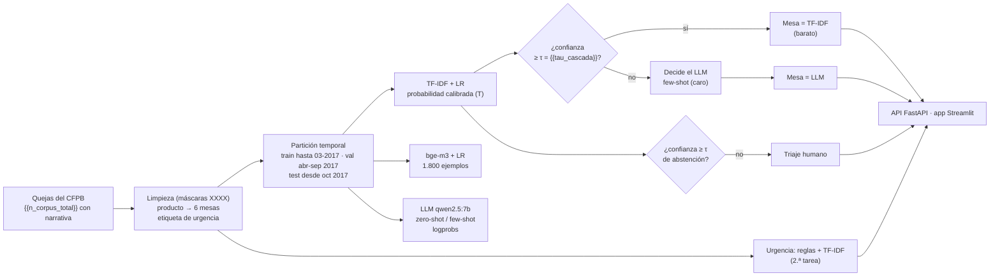

# 📨 Enrutamiento de quejas financieras: TF-IDF vs. embeddings vs. LLM, cascada y urgencia

<!-- Archivo generado por `python -m quejas.informe` desde scripts/plantillas/README.md: todas las cifras salen de reports/resultados.json. -->

¿Hace falta un **LLM local** para enrutar quejas financieras a la mesa correcta, o basta un **TF-IDF + regresión
logística**? Este proyecto lo mide con **{{n_corpus_total}} quejas reales del CFPB** (*Consumer Financial Protection
Bureau*, EE. UU.; textos originales **en inglés**) con una **partición temporal** (entrenar con quejas antiguas, probar
con recientes), compara 5 enfoques y 2 cascadas **sobre las mismas {{n_test_comun}} quejas**, detecta **urgencia**
(fraude, ejecución hipotecaria, reposesión, amenazas legales) y prueba la transferencia a **español**. Todo corre en
local y en CPU con Ollama (`qwen2.5:7b`, `bge-m3`), con API FastAPI y app Streamlit.


---

## 🎯 Conclusiones

1. **Sin ejemplos, el LLM pierde claramente; con 6 ejemplos queda al nivel de los clasificadores baratos, sin
   superarlos.** Sobre las mismas {{n_test_comun}} quejas recientes: TF-IDF + LR **{{f1_tfidf}}** (IC 95 % {{f1ic_tfidf}}),
   LLM zero-shot **{{f1_llm0}}** ({{f1ic_llm0}}), LLM few-shot **{{f1_llm1}}** ({{f1ic_llm1}}). Pasar de 0 a 6 ejemplos
   sube el Macro-F1 en {{dif_llm1_llm0}} (IC pareado {{dific_llm1_llm0}}). La ventaja de TF-IDF sobre el few-shot
   ({{dif_tfidf_llm1}}, IC {{dific_tfidf_llm1}}) es **{{dist_tfidf_llm1}}** con 300 quejas: no se puede decir cuál es
   mejor, sí que TF-IDF tarda {{ms_tfidf}} por queja y el LLM {{ms_llm1}}.
2. **Por qué falla el zero-shot (matriz de confusión):** manda a «reporte de crédito» quejas que el CFPB archivó en otra
   mesa: {{confusiones_llm0}}. Las quejas de cobranza y de tarjetas suelen mencionar el reporte de crédito, pero la
   etiqueta del CFPB sigue al producto que eligió el consumidor. Con 6 ejemplos ese sesgo baja, aunque cobranza →
   reporte sigue siendo su error más frecuente.
3. **La cascada no empeora nada y quizá ayuda un poco, pero no está demostrado.** Con el umbral fijado en validación
   llega al LLM el {{pct_al_llm}} de las quejas; la cascada con few-shot logra {{f1_casc1}} ({{f1ic_casc1}}) frente a
   {{f1_tfidf}} de TF-IDF solo: {{dif_casc1_tfidf}} (IC {{dific_casc1_tfidf}}, {{dist_casc1_tfidf}}), con
   ~{{ms_casc1}} de latencia media. Con zero-shot: {{f1_casc0}} ({{dist_casc0_tfidf}} de TF-IDF).
4. **La deriva temporal es real y medible:** el mismo TF-IDF baja de {{f1_deriva_vieja}} (misma época que el
   entrenamiento) a {{f1_deriva_nueva}} en quejas recientes (diferencia {{dif_deriva}}, IC {{dif_deriva_ic}}). Una
   partición aleatoria habría sobreestimado el desempeño en producción.
5. **Con pocas etiquetas, embeddings; con cientos, TF-IDF alcanza.** Con 10 ejemplos por mesa, bge-m3 + LR da
   {{fs_emb_10}} y TF-IDF {{fs_tf_10}}; con 300 por mesa, {{fs_emb_300}} vs. {{fs_tf_300}}. TF-IDF con las 25.722 quejas
   ({{f1_tfidf}}) apenas mejora sobre TF-IDF con 1.800 ({{f1_tfidf_p}}): en quejas recientes el límite lo pone la
   deriva y la ambigüedad de las etiquetas, no la cantidad de datos.
6. **Urgencia: ningún detector es bueno todavía.** En las {{urg_n_rec}} quejas recientes, TF-IDF + LR logra F1
   {{urg_f1_tfidf_rec}} (precisión {{urg_prec_tfidf_rec}}, exhaustividad {{urg_rec_tfidf_rec}}) y las reglas
   {{urg_f1_reglas_rec}}. En el conjunto común solo hay {{urg_pos_co}} urgentes: las diferencias entre TF-IDF, reglas y
   LLM caben dentro de sus intervalos.
7. **Español:** en 60 quejas reales traducidas, TF-IDF cae de {{en_aciertos_tfidf}} a {{es_aciertos_tfidf}} aciertos
   (su vocabulario es inglés); bge-m3 + LR pasa de {{en_aciertos_emb}} a {{es_aciertos_emb}} y el LLM few-shot de
   {{en_aciertos_llm1}} a {{es_aciertos_llm1}}. Con 60 quejas, bge-m3 + LR y el LLM few-shot no se distinguen entre sí;
   lo claro es que para quejas en español no sirve el TF-IDF entrenado en inglés.

---

## 🧠 Arquitectura



El umbral de la cascada, la temperatura de calibración, el de abstención y el de urgencia se eligen en **validación**
y se reportan en **prueba**; cada pieza se evalúa por separado sobre las mismas quejas.

---

## 📌 El problema y los datos

Una entidad financiera recibe quejas en texto libre que deben llegar a una de **6 mesas**. Las mesas son una
**agrupación propia** de los productos del CFPB (no una taxonomía oficial):

{{tabla_mapeo}}

- **Origen:** espejo Parquet público del CFPB ({{n_parquet}} filas). Se conservan {{n_corpus_total}} narrativas de 15 a
  260 palabras, sin duplicados, recibidas entre {{fecha_min}} y {{fecha_max}}. El CFPB enmascara datos personales con
  `XXXX`; se eliminan antes de TF-IDF.
- **Partición temporal** (no aleatoria): las quejas se ordenan por fecha de recepción.

{{tabla_particiones}}

- **train** ({{n_train_tfidf}}): recibidas hasta el 31-03-2017, con la lista de productos antigua del CFPB.
- **reserva misma época** ({{n_test_misma_epoca}}): sorteadas de ese mismo período; sirven para medir la deriva.
- **val** ({{n_val}}, abril–septiembre de 2017): **todos** los umbrales y la calibración se eligen aquí.
- **test** ({{n_test_reciente}}, desde octubre de 2017). Dentro de test, el **conjunto común**: {{n_test_comun}} quejas
  balanceadas por mesa que evalúan **todos** los enfoques, incluido el LLM.
- `bge-m3 + LR` se entrena con {{n_train_embeddings}} quejas (300 por mesa) del train porque cada embedding cuesta
  ~0,8 s en esta CPU (25.722 serían ~6 h); la curva de aprendizaje muestra cuánto se pierde por eso.

---

## 🏆 Resultados en el conjunto común ({{n_test_comun}} quejas recientes, balanceadas)

{{tabla_principal}}

IC 95 % por bootstrap (1.000 remuestreos de quejas). Brier multiclase: menor es mejor (0 = perfecto). Las
probabilidades del LLM salen de los **logprobs** de la primera ficha de la categoría. Latencias en una CPU sin GPU con
otro proceso usando Ollama al mismo tiempo: son órdenes de magnitud.

**Diferencias pareadas** (las mismas quejas en cada remuestreo; «no distinguible» = el IC incluye 0):

{{tabla_diferencias}}

| Comparación de enfoques | Curva de aprendizaje |
|---|---|
|  |  |

{{tabla_few_shot}}

### Cascada barato → LLM

TF-IDF + LR decide cuando su probabilidad **calibrada** es ≥ {{tau_cascada}}; si no, decide el LLM. El umbral se fijó en
validación para que el {{fraccion_objetivo}} de menor confianza vaya al LLM; en prueba llegó al LLM el {{pct_al_llm}}.
La curva de abajo recorre todos los umbrales sobre el conjunto de prueba: sirve para ver la forma (el few-shot nunca
baja de TF-IDF solo hasta que recibe más de la mitad de las quejas; el zero-shot sí), no para elegir el punto, porque
elegirlo ahí sería ajustar con la prueba.


### ¿En qué se equivocan?


Confusiones más frecuentes del LLM zero-shot: {{confusiones_llm0}}. De TF-IDF: {{confusiones_tfidf}}.

---

## 🧭 Confianza del LLM: por qué no se usa la que el LLM escribe

Se probó pedirle al LLM un campo `confianza` en el JSON: **{{auto_099}} de {{auto_n}} respuestas decían 0,99**
(`data/experimento_confianza_autodeclarada.jsonl`), así que no servía para decidir nada. En su lugar se compararon
cuatro señales por su AUROC para separar aciertos de errores del LLM (0,5 = azar):

{{tabla_senales}}


- La probabilidad de los **logprobs** del LLM sí varía (no es siempre 0,99), pero separa mal aciertos de errores
  (AUROC {{auroc_logprob_llm0}} en zero-shot y {{auroc_logprob_llm1}} en few-shot): el {{pct_logprob_099_llm0}} de las
  respuestas zero-shot tienen probabilidad ≥ 0,99, incluidas muchas equivocadas.
- La mejor alarma es el **desacuerdo con TF-IDF** (AUROC {{auroc_acuerdo_tfidf_llm0}} / {{auroc_acuerdo_tfidf_llm1}}).
  El acuerdo entre zero-shot y few-shot ayuda para el zero-shot ({{auroc_acuerdo_modos_llm0}}) pero casi nada para el
  few-shot ({{auroc_acuerdo_modos_llm1}}): cuando discrepan ({{n_discrepan}} quejas), el few-shot acierta el
  {{acc_si_discrepan}}.
- **Por eso la cascada y la abstención usan la probabilidad calibrada del clasificador barato**: se calcula para
  todas las quejas antes de llamar al LLM, se calibra y se elige su umbral en validación sin gastar llamadas, y en
  prueba se comporta como dice (curva de confiabilidad cerca de la diagonal). Varias muestras del LLM costarían
  varias llamadas más por queja (y con temperatura 0 devolverían lo mismo).

---

## 📉 Deriva temporal

TF-IDF + LR entrenado con quejas hasta marzo de 2017: Macro-F1 **{{f1_deriva_vieja}}** ({{f1ic_deriva_vieja}}) en la
reserva de la misma época vs. **{{f1_deriva_nueva}}** ({{f1ic_deriva_nueva}}) en las {{n_test_reciente}} quejas desde
octubre de 2017. Diferencia {{dif_deriva}} (IC 95 % {{dif_deriva_ic}}). La caída coincide con el cambio de abril de
2017, cuando el CFPB renombró productos y motivos de su formulario (las mesas absorben los nombres nuevos); no separé
cuánto se debe a eso y cuánto a otros cambios (empresas, temas nuevos como las criptomonedas).


{{tabla_trimestres}}

{{tabla_deriva_mesa}}

Nota: la reserva de la misma época tiene otra mezcla de mesas que las recientes (en 2018 crece «reporte de crédito»);
el Macro-F1 promedia por mesa y amortigua ese efecto, pero no lo elimina.

---

## 🎚️ Calibración, umbral de abstención y Brier

bge-m3 + LR (1.800 quejas de entrenamiento) tiene Brier {{brier_sin_emb}} sin calibrar; su temperatura óptima
en validación es T = {{temp_emb}} (< 1: el modelo es **subconfiado**, su confianza media es {{confmedia_sin_emb}} con
{{accc_emb}} de exactitud) y al calibrar baja a {{brier_cal_emb}} (ECE {{ece_sin_emb}} → {{ece_cal_emb}}). Un
clasificador lineal regularizado entrenado con pocas quejas tiende a aplanar sus probabilidades. TF-IDF ya está calibrado (T = {{temp_tfidf}}, Brier
{{brier_sin_tfidf}} → {{brier_cal_tfidf}}).
El LLM no se puede calibrar sin gastar llamadas en validación: su Brier es {{brier_llm0}} (zero-shot) y
{{brier_llm1}} (few-shot) y es sobreconfiado.


**Abstención a triaje humano.** Con 14 USD por queja mal enrutada y 3,50 USD por revisarla a mano, el umbral de mínimo
costo se eligió en validación y se aplicó en prueba: para TF-IDF + LR, τ = {{tau_abst_tfidf}} automatiza el
{{cob_abst_tfidf}} de las quejas con {{accauto_abst_tfidf}} de exactitud (sin abstención: {{acc0_abst_tfidf}}) y
ahorra el {{ahorro_abst_tfidf}} del costo. Para bge-m3 + LR, τ = {{tau_abst_emb}}: {{cob_abst_emb}} automatizado,
{{accauto_abst_emb}} de exactitud, ahorro {{ahorro_abst_emb}}.

---

## 🚨 Segunda tarea: urgencia

«Urgente» = el consumidor eligió en el formulario del CFPB un motivo de fraude o robo de identidad, riesgo de
ejecución hipotecaria (incluye «Loan modification, collection, foreclosure» y «Struggling to pay mortgage»),
reposesión del vehículo, o amenazas de arresto, embargo o demanda sin aviso ({{pct_urgente_corpus}} del corpus). La
etiqueta no sale del texto, así que mide a los detectores de forma independiente, pero es ruidosa.

{{tabla_urgencia}}


{{tabla_urgencia_tipo}}

Por tipo (tabla anterior): las reglas encuentran más casos de fraude, reposesión y amenazas legales, a costa de
marcar muchas quejas que no son urgentes; TF-IDF es más preciso y encuentra más casos de ejecución hipotecaria (el
tipo más frecuente en el entrenamiento), pero se le escapan los tipos minoritarios. Para producción convendría
combinar ambos (marcar si cualquiera lo marca) y revisar a mano una muestra de la etiqueta, que es un proxy ruidoso.

---

## 🌎 Español

Las {{n_test_espanol}} quejas en español son **traducciones de quejas reales** del conjunto común (las primeras ~80
palabras), con su etiqueta del CFPB, hechas con Claude (un modelo distinto de qwen2.5:7b, para no favorecerlo) y sin
revisión de un traductor profesional. Se eligieron traducciones de quejas reales y no textos redactados por una IA,
que serían más limpios y fáciles. Ningún modelo vio español al entrenar.

{{tabla_espanol}}


- **TF-IDF** acierta {{es_aciertos_tfidf}} de 60 en español frente a {{en_aciertos_tfidf}} con las mismas quejas en
  inglés: su vocabulario se aprendió en inglés y casi no se comparte con el español.
- **bge-m3 + LR** ({{es_aciertos_emb}}/60) y el **LLM few-shot** ({{es_aciertos_llm1}}/60) conservan la mayor parte
  de su desempeño; sus intervalos ({{esic_emb}} y {{esic_llm1}}) se solapan casi por completo, así que no hay un
  ganador. El LLM zero-shot acierta {{es_aciertos_llm0}}/60.
- En la **cascada**, el {{pct_es_al_llm}} de las quejas en español saca baja confianza en TF-IDF y va al LLM (frente al
  {{pct_en_al_llm}} de las mismas quejas en inglés), así que la cascada se defiende sola: acierta {{es_aciertos_casc1}}/60.
- Asimetría a tener en cuenta: la versión en español traduce las primeras ~80 palabras, mientras que los modelos
  ven hasta 110 palabras del original en inglés.

---

## 🖥️ App, API y reproducción

```powershell
streamlit run app/app_streamlit.py     # pega una queja: ruta (TF-IDF → LLM o triaje), decisión y urgencia
uvicorn api.main:app --reload          # /clasificar, /enrutar (cascada + urgencia), /enrutar_lote
powershell -ExecutionPolicy Bypass -File .\evaluar_en_mi_pc.ps1   # reproduce todo con lo grabado, sin Ollama
```

Guía detallada: **[docs/GUIA_PASO_A_PASO.md](docs/GUIA_PASO_A_PASO.md)** · Ficha: **[MODEL_CARD.md](MODEL_CARD.md)**

Las corridas lentas (embeddings y LLM) son **reanudables** y quedan grabadas en `data/`: la evaluación, `pytest`, la
API y la app corren sin Ollama. El README, la ficha y la guía se generan con `python -m quejas.informe` y una prueba
verifica que sus cifras coincidan con `reports/resultados.json`.

```text
├── descargar_datos.py          descarga del CFPB, mapeo producto → mesa, urgencia y particiones temporales
├── data/                       embeddings y respuestas del LLM grabadas, ejemplos few-shot, quejas traducidas
├── src/quejas/
│   ├── grabar.py               corridas reanudables contra Ollama (embeddings, LLM zero/few-shot)
│   ├── llm.py                  cliente Ollama, prompt, JSON Schema y probabilidades desde logprobs
│   ├── modelos.py              TF-IDF, bge-m3, LLM, cascada, calibración por temperatura, urgencia
│   ├── evaluacion.py           IC bootstrap, diferencias pareadas, Brier, ECE, AUROC, abstención
│   ├── entrenar.py             pipeline completo → reports/ y models/
│   ├── informe.py              genera README, MODEL_CARD y guía desde reports/resultados.json
│   └── predecir.py             ruta de una queja (usado por la API y la app)
├── api/main.py · app/app_streamlit.py
├── notebooks/                  3 notebooks ejecutados (datos y deriva · comparación y cascada · urgencia, español y API)
└── tests/                      pruebas con pytest (sin Ollama)
```

**Código y datos:** el **código** es MIT (ver [`LICENSE`](LICENSE)); los **datos** (Consumer Complaint Database del CFPB) son de dominio público y se descargan con `descargar_datos.py`; las 60 quejas en español son traducciones propias de quejas reales y se publican con la misma condición que su fuente.

**Fuente:** Consumer Complaint Database — CFPB (dominio público): <https://www.consumerfinance.gov/data-research/consumer-complaints/> · espejo Parquet: <https://huggingface.co/datasets/milesbutler/consumer_complaints>.

---

**Erick Guarnizo** · proyecto de portafolio (IA y NLP)
