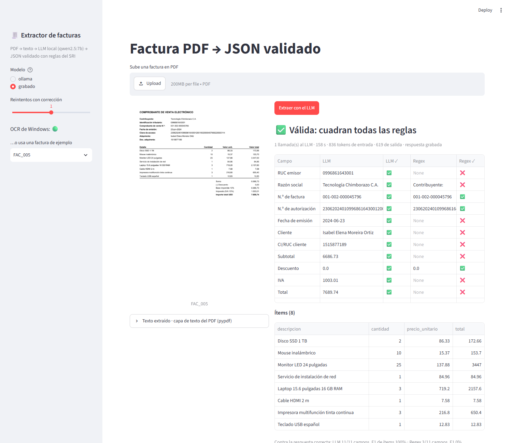
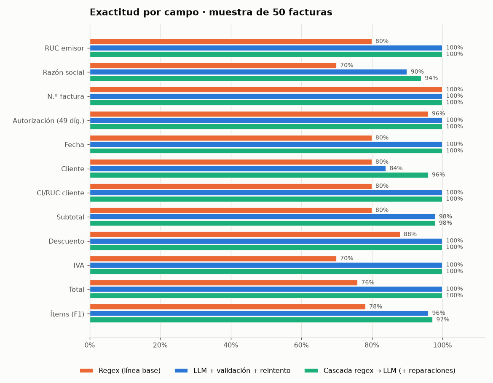
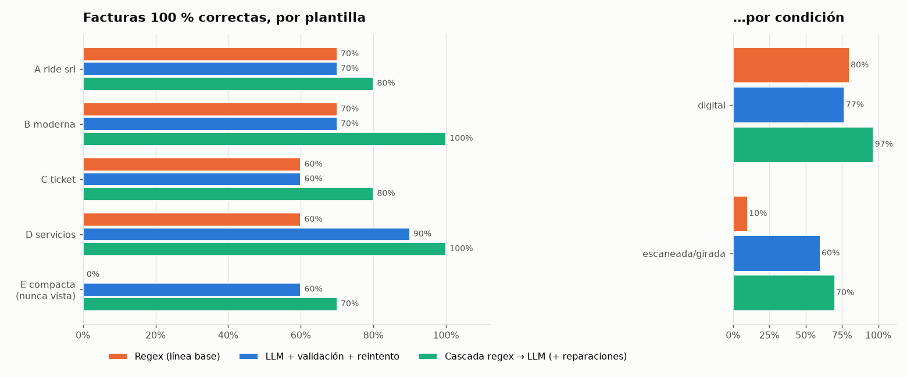
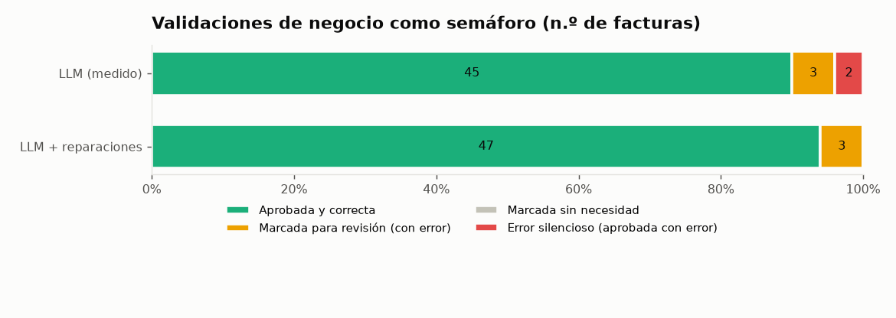
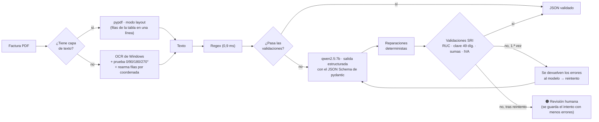
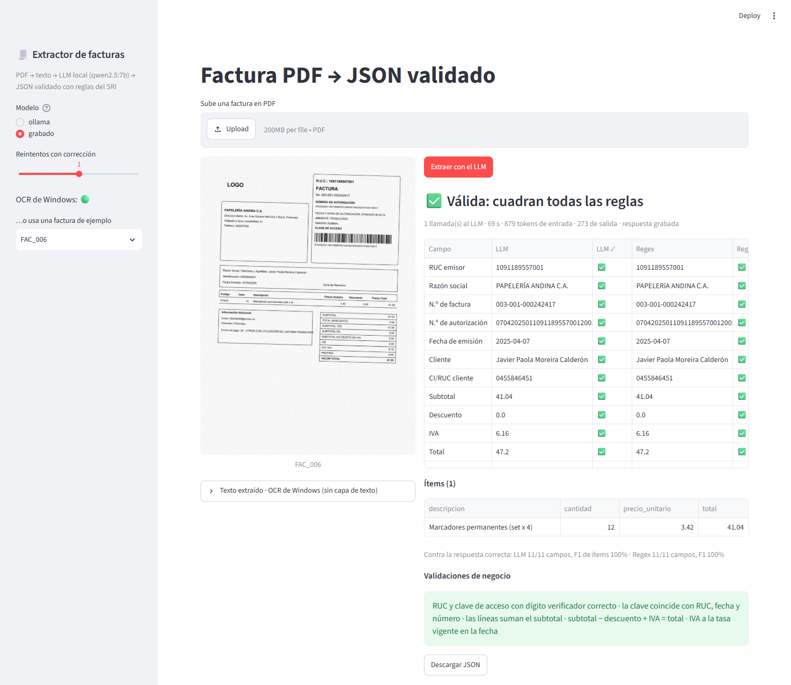
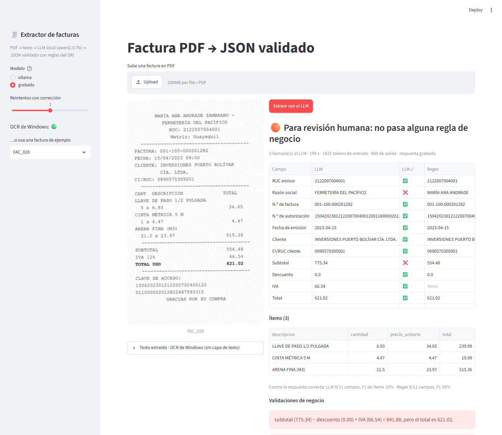

# 🧾 Extracción de facturas PDF a JSON validado (LLM local + reglas del SRI)

Convierte facturas ecuatorianas en PDF (digitales, **escaneadas** o **giradas**) en un JSON estructurado y **validado
con reglas de negocio**: RUC y clave de acceso con dígito verificador, ítems que suman el subtotal, subtotal − descuento
+ IVA = total, IVA del 12 % o 15 % según la fecha. Corre **100 % local y gratis**: pypdf, el OCR que ya trae Windows y
`qwen2.5:7b` en Ollama, en un PC **sin GPU**. Se comparó con una línea base de expresiones regulares sobre 200 facturas
sintéticas de 5 diseños distintos, uno de ellos **nunca visto** al escribir la regex ni el prompt.




---

## 🏆 Resultados (qwen2.5:7b local, CPU)

Misma muestra de **50 facturas** para todos los métodos (10 por plantilla, estratificada: 20 escaneadas/giradas,
10 con campos faltantes). La regex se midió además en las 200. Entre corchetes, el **IC 95 %** (n = 50): bootstrap de
facturas para campos e ítems, intervalo de Wilson para las facturas perfectas.

| Método | Campos exactos | F1 de ítems | Facturas 100 % correctas | Tiempo por factura |
|---|---:|---:|---:|---:|
| Regex (línea base) | 81,8 % [73,3–89,6] | 78,2 % [68,0–86,5] | 52 % [39–65] | **0,9 ms** |
| **LLM + validación + reintento** (medido) | **97,5 %** [96,0–98,7] | **96,1 %** [91,6–99,3] | **70 %** [56–81] | ~2 min |
| LLM + reparaciones deterministas ¹ | 98,2 % [96,7–99,5] | 97,2 % [93,0–100] | 82 % [69–90] | ~2 min |
| **Cascada: regex → LLM solo si la regex no valida** ¹ | **98,9 %** [97,8–99,8] | **97,2 %** [93,0–100] | **86 %** [74–93] | LLM en el **46 %** de las 50 (30 % de las 200) ² |

¹ Las reparaciones se escribieron **después** de ver los errores de la corrida: son cifras optimistas (ver *Lectura
honesta*). Además, los IC de las tres filas del LLM se solapan: con 50 facturas no se distingue el 70 % medido del
82–86 % de las filas optimistas.
² La muestra de 50 está estratificada y lleva más facturas difíciles (escaneadas y la plantilla E) que las 200: en la
muestra la regex no valida el 46 % de las facturas y la cascada llama al LLM en esas; en las 200 son el 30 %.

| Dónde se nota la diferencia | Regex | LLM (medido) |
|---|---:|---:|
| **Plantilla E, nunca vista** (coma decimal `1.234,56`, fecha `23-jun-2024`, otras etiquetas), n = 10 | **0 %** perfectas [0–28] · F1 ítems **0 %** | **60 %** perfectas [31–83] · campos 97 % [95–100] · F1 ítems 92 % [74–100] |
| **Escaneadas o giradas** (OCR), n = 20 | **10 %** perfectas [3–30] | **60 %** perfectas [39–78] |
| Digitales de las plantillas A–D (para las que se escribió) | **100 %** (135/135 en las 200) | 79 % (19/24 en la muestra) ³ |
| Campos que NO están impresos: ¿devuelve null o inventa? | 12/12 null | 11/12 null · **1 inventado** |

³ Contando también las 6 digitales de la plantilla E, el LLM acierta 23 de 30 (77 %).

| Pieza | Resultado |
|---|---|
| OCR nativo de Windows | 29 facturas sin capa de texto · **0,33 s** por página · **7/7** páginas giradas enderezadas |
| Validaciones como semáforo (LLM medido) | 45 aprobadas y correctas · **3** marcadas para revisión (las 3 con error) · **2** errores silenciosos ² |
| Reintento con corrección | 3 facturas reintentadas, **0 arregladas** (las 3 escaneadas con OCR dañado: ver abajo) |
| Costo del LLM | media 134 s · mediana 120 s · p90 205 s · 1,06 llamadas · 879 tokens de entrada y 504 de salida |

² En campos validables o ítems; eran descripciones de ítems y las reparaciones los llevan a 0. Los **nombres** no los
valida ninguna regla: ahí están los errores silenciosos que quedan (razón social 90 %, cliente 92 %).

| | | |
|---|---|---|
|  |  |  |

### 🔍 Qué aprendí de los errores

- **La regex es perfecta… hasta que cambia el formato.** 135 de 135 facturas digitales correctas en los diseños para
  los que la escribí, 0,9 ms cada una. En el diseño E, que no miré, no saca **ni un ítem** (lee `86,33` como texto) y
  confunde la razón social con la etiqueta "Contribuyente:". El LLM, sin cambiar una línea, saca el 97 % de los campos.
- **El LLM se equivoca en lo que no tiene regla.** En una factura cuyo emisor es una persona natural **intercambió el
  nombre del emisor y el del cliente**: todos los montos cuadraban y pasó como válida. Las validaciones protegen
  cifras e identificadores, no nombres.
- **"CONSUMIDOR FINAL" → null.** En 3 facturas el modelo puso la identificación 9999999999999 pero dejó el nombre vacío;
  en otra hizo lo contrario (puso 9999999999999 como nombre de un cliente que no estaba impreso: el único dato inventado).
- **El reintento no arregla una mala lectura.** Las 3 facturas que no pasaron la validación eran escaneadas y el OCR
  había dañado el texto ("IVA 12%" → `IVA 1296`, cantidades y precios de un ticket en columnas corridas). Devolverle
  al modelo "el total no cuadra" no sirve si el número correcto no está en el texto; en una, el reintento movió el error
  de un campo a otro. Lo valioso fue **marcarlas para revisión humana** en vez de aprobarlas.
- **El descuento con signo.** La plantilla B imprime `Descuento -$3.14`; el modelo copiaba el signo y el total dejaba de
  cuadrar. La validación lo detectó en la primera prueba, pero el reintento tampoco lo corregía: se resolvió en el
  esquema (el descuento se guarda siempre positivo).

### Lectura honesta

- **Datos sintéticos.** Generar las facturas da la verdad exacta de cada campo y permite publicarlas, pero son más
  limpias que las reales (sin sellos, firmas, manchas, letra a mano ni varias páginas). Las cifras son un **techo**.
- **Dos cifras cuando corregí viendo los errores.** Las reparaciones (consumidor final, cantidad × precio pegados a la
  descripción) y la normalización de puntuación en la métrica (`CIA. LTDA` = `Cía. Ltda.`, aplicada a todos los
  métodos) llegaron después de la corrida. Por eso la fila "medido" (70 % perfectas) es la cifra honesta y 82–86 % es
  optimista: se diseñó mirando estas mismas 50 facturas.
- **Muestra pequeña para el LLM.** Cada llamada tarda 1–3 min en un CPU compartido (~5 tokens/s; los 49 dígitos de la
  clave de acceso cuestan casi un token cada uno): las 200 facturas eran ~7 h. Con 50, cada factura vale 2 puntos y
  10 por plantilla no permiten afirmar diferencias pequeñas entre plantillas (los IC 95 % de arriba van de ±3 puntos
  en campos exactos a ±12–25 en facturas perfectas). Sí es claro que el LLM supera a la regex en la plantilla E y en
  las escaneadas.
- **La métrica de ítems es estricta.** Un ítem cuenta solo si la descripción se parece ≥ 0,85 *y* cantidad, precio y
  total son exactos. "LLAVE DE PASO 1/2 PULGADA 25 x 6.84" con los montos bien cuenta como error.
- **Tolerancia por línea demasiado holgada.** La regla `cantidad × precio = total` acepta 0,5 % de diferencia; en un
  ticket escaneado el modelo corrió las columnas y una línea pasó por estar dentro de ese margen (la factura igual quedó
  marcada por el total). Bajarla a ±0,02 USD es el siguiente cambio; no lo hice para no invalidar la corrida grabada.
- **Contra la regex no es una pelea justa en las plantillas vistas:** la escribí mirándolas. Por eso existe la
  plantilla E.

## 🧠 Arquitectura



| Decisión | Por qué |
|---|---|
| **Salida estructurada** con el esquema pydantic | Ollama solo puede generar JSON con esos campos y tipos: no hay que "parsear" texto libre y nunca falló el JSON en 53 llamadas. |
| **Campos en el orden de la factura** (emisor → número → autorización → fecha → cliente → ítems → totales) | Ollama genera el JSON en el orden del esquema; lección del RAG de normativa aduanera (proyecto IA), donde un orden distinto costó 40 puntos. |
| **Validaciones del SRI** en vez de "confiar" | El dígito verificador del RUC (módulo 10/11) y de la clave de acceso (módulo 11), más el cruce clave ↔ RUC/fecha/número, detectan un dígito mal copiado o el RUC del cliente puesto como emisor. Las sumas detectan ítems perdidos. |
| **Reintento con los errores en lenguaje natural** | "subtotal (775,34) − descuento + IVA (66,54) = 841,88, pero el total es 621,02": el modelo sabe qué revisar. Máx. 1 reintento (cada llamada cuesta ~2 min). |
| **Cascada regex → LLM** | La regex resuelve el 70 % de las 200 facturas en 1 ms (54 % en la muestra de 50, que lleva más difíciles) y, cuando falla, las validaciones casi siempre lo notan. El LLM solo entra en el resto: 30 % de las 200, 46 % de las 50. |
| **OCR nativo de Windows** (`winrt`) | Sin instalar Tesseract ni descargar modelos; 0,33 s por página. En Linux/Mac queda desactivado y la app lo avisa. |
| **`pypdf` en modo layout** | El modo normal pone cada celda en su propia línea y se pierde qué cantidad va con qué precio. |
| **Plantilla nunca vista** | Medir la regex solo en los formatos para los que se escribió la haría parecer perfecta. |
| **Modo grabado** | Cada llamada al LLM quedó guardada: las pruebas, la app y la evaluación se reproducen sin Ollama, y una corrida cortada se reanuda (se cortó 3 veces). |

## 🧪 Los datos: 200 facturas sintéticas

| Plantilla | Diseño | Lo difícil |
|---|---|---|
| **A · RIDE del SRI** | dos recuadros, tabla de 6 columnas, 9 líneas de totales | `SUBTOTAL` vs `SUBTOTAL 15%`; razón social en 2 líneas |
| **B · Moderna** | banda de color, "Facturar a", autorización al pie | `Descuento -$3.14` con signo; `$` en cada monto |
| **C · Ticket 80 mm** | Courier, ítems en 2 líneas | clave de acceso partida en 2 líneas; nombres cortados |
| **D · Servicios** | membrete, sin tabla, fecha en letras | "1. Humita — 1 × $1.40 = $1.40"; "1 de noviembre de 2023" |
| **E · Compacta (nunca vista)** | etiquetas distintas | `1.234,56`, `23-jun-2024`, "Contribuyente", "Adquirente", "Suma" |

- **Ruido:** 22 escaneadas (imagen sin texto, inclinada ±2°, ruido, desenfoque, JPEG de baja calidad) y 7 además
  giradas 90/180/270°; 22 con campos faltantes (sin autorización, sin cliente o sin identificación → la verdad es null).
- **Montos coherentes:** IVA del 12 % hasta el 31-III-2024 y 15 % desde el 1-IV-2024; 25 % con descuento; 1–12 ítems
  de 6 sectores (ferretería, tecnología, papelería, servicios, restaurante, limpieza).
- **Nada real:** nombres por combinación aleatoria de nombres y apellidos comunes; RUC y cédulas aleatorios que solo
  cumplen el dígito verificador. Reproducibles con semilla fija (`python generar_datos.py`, ~10 s).

| Escaneada (OCR) | Ticket escaneado, marcado para revisión |
|---|---|
|  |  |

## 🚀 Cómo ejecutarlo

Guía completa para Windows y preguntas de entrevista: **[docs/GUIA_PASO_A_PASO.md](docs/GUIA_PASO_A_PASO.md)**

```bash
ollama pull qwen2.5:7b
pip install -r requirements.txt && pip install -e .
python generar_datos.py                          # 200 facturas en data/raw (~10 s)
pytest                                           # 20 pruebas, sin Ollama ni red
streamlit run app/streamlit_app.py               # sube un PDF
python -m facturas.extractor factura.pdf         # una factura desde la terminal
FACTURAS_GRABAR=1 python -m facturas.correr_llm  # evaluación con el LLM (~2 h en CPU, reanudable)
python -m facturas.evaluar                       # métricas y figuras
```

**Sin Ollama:** `FACTURAS_PROVEEDOR=grabado streamlit run app/streamlit_app.py` y elige una factura de ejemplo:
se reproducen las respuestas grabadas en la evaluación. En Windows, todo en un comando:
`powershell -ExecutionPolicy Bypass -File .\evaluar_en_mi_pc.ps1`.

## 📁 Estructura

```
├── src/facturas/
│   ├── generar.py        200 facturas sintéticas: 5 plantillas (reportlab), escáner simulado, verdad JSON
│   ├── sri.py            cédula, RUC (módulo 10/11), clave de acceso de 49 dígitos, tasa de IVA por fecha
│   ├── esquema.py        modelo pydantic = verdad + JSON Schema para Ollama + validador de tipos
│   ├── texto.py          pypdf (layout) · OCR de Windows · detección de orientación · filas por coordenada
│   ├── regex_base.py     línea base sin LLM (escrita mirando las plantillas A–D)
│   ├── llm.py            cliente Ollama + modo grabado
│   ├── extractor.py      prompt, salida estructurada, validación y reintento con corrección
│   ├── validaciones.py   reglas de negocio con mensajes en español (para el usuario y para el modelo)
│   ├── reparaciones.py   correcciones deterministas posteriores (consumidor final, descripciones)
│   ├── metricas.py       exactitud por campo, F1 de ítems, factura perfecta
│   ├── correr_llm.py     corrida reanudable sobre la muestra estratificada
│   ├── evaluar.py        regex vs LLM vs cascada, por plantilla y condición, semáforo, costo
│   └── graficos.py
├── app/streamlit_app.py  subir PDF → JSON validado, comparado con la regex y con la verdad
├── tests/                20 pruebas (LLM simulado o grabado; OCR se salta fuera de Windows)
├── data/muestras/        10 facturas de ejemplo con su verdad (2 por plantilla)
├── data/catalogo.csv     plantilla, condición y campos faltantes de cada factura
├── data/textos.jsonl     texto extraído de las 200 (evita repetir el OCR)
├── data/grabacion_llm.jsonl   las 53 llamadas al LLM de la evaluación
├── reports/              evaluacion.json, detalle por factura y método, predicciones, figuras, capturas
└── generar_datos.py · evaluar_en_mi_pc.ps1
```

## 📚 Fuentes y licencia

- **Datos:** facturas **sintéticas** generadas por este proyecto (`src/facturas/generar.py`), sin datos de personas
  reales; se publican con licencia [CC0 1.0](https://creativecommons.org/publicdomain/zero/1.0/).
- **Reglas:** formato de la clave de acceso y del RIDE según la *Ficha técnica de comprobantes electrónicos* del
  [SRI](https://www.sri.gob.ec/facturacion-electronica); algoritmos públicos de validación de cédula y RUC
  (módulo 10 y módulo 11); IVA del 15 % desde el 1 de abril de 2024.
- **Modelo:** [Qwen2.5-7B-Instruct](https://ollama.com/library/qwen2.5) vía Ollama (licencia Apache 2.0).
- **Código:** MIT (ver [`LICENSE`](LICENSE)). Los **datos** (las facturas sintéticas) son CC0 1.0, como se indica arriba.

---

**Erick Guarnizo** · proyecto de portafolio (IA)
