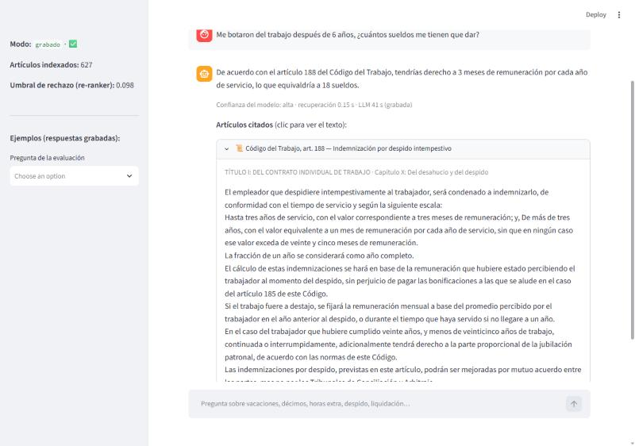
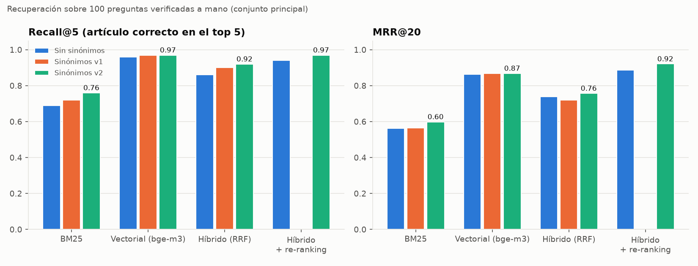
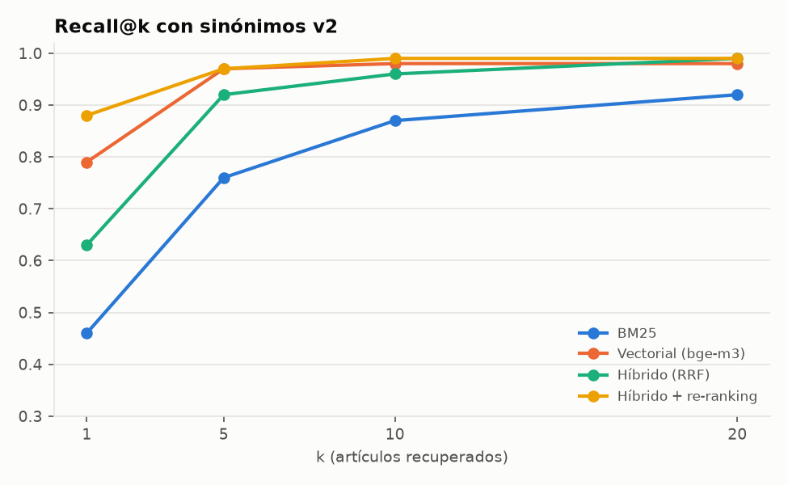
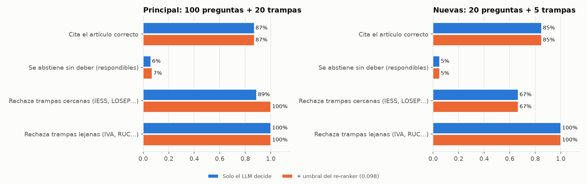
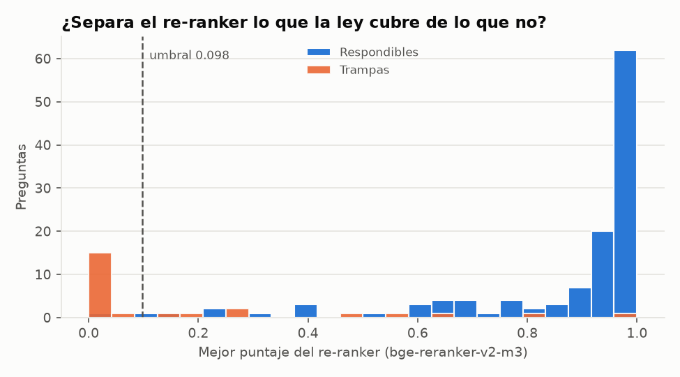
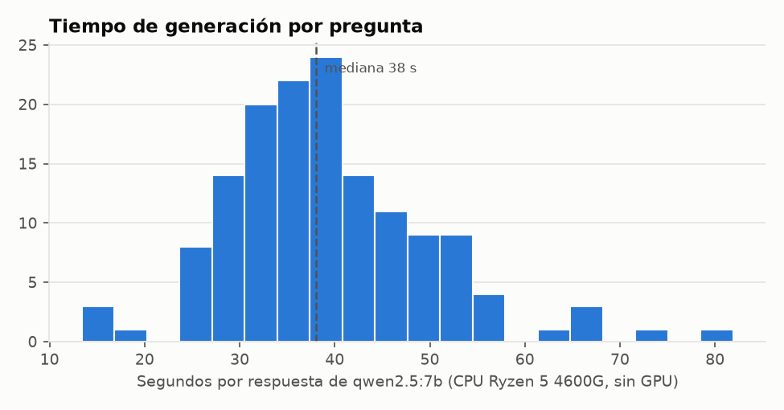
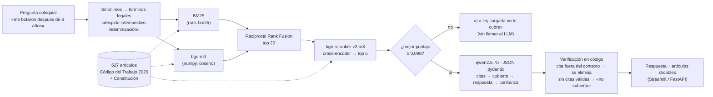

# ⚖️ Asistente RAG de la ley laboral del Ecuador (búsqueda híbrida + re-ranking + rechazo)

Responde preguntas de trabajadores y pequeñas empresas (vacaciones, décimos, horas extra, despido, liquidación)
**citando el artículo exacto** del Código del Trabajo (607 artículos, última reforma 2026-04-09) y de la Constitución
(20 artículos laborales), y **dice que no lo sabe** cuando la ley cargada no lo cubre. Corre 100 % local y gratis
(qwen2.5:7b + bge-m3 en Ollama, bge-reranker-v2-m3 en CPU) y se evaluó pieza por pieza con **145 preguntas escritas y
verificadas a mano** (120 con su artículo correcto y 25 trampas).


> ⚠️ **No reemplaza a un abogado.** Da información general basada en el texto de la ley vigente a la fecha indicada;
> una reforma posterior o un caso particular pueden cambiar la respuesta. La propia evaluación muestra que el modelo
> se equivoca en cálculos (ver abajo).



*La cita abre el texto del artículo para verificarlo. En esta captura real el modelo cita bien el art. 188 pero calcula
mal («18 sueldos»; son 6): por eso la cita siempre se muestra junto a la respuesta.*

---

## 🏆 Resultados (corrida real del 2026-10-25)

### Recuperación: ¿el artículo correcto llega a los 5 que lee el LLM?

Conjunto principal (100 preguntas respondibles), sinónimos v2, con el IC 95 % por bootstrap de preguntas entre
corchetes · entre paréntesis, el valor sin sinónimos:

| Método | Recall@5 | MRR@20 | Artículo correcto en 1.er lugar |
|---|---:|---:|---:|
| BM25 (**línea base**) | 0,76 [0,67–0,84] (0,69) | 0,60 [0,52–0,67] (0,56) | 46 % |
| Vectorial bge-m3 | 0,97 [0,93–1,00] (0,96) | 0,87 [0,82–0,92] (0,86) | 79 % |
| Híbrido (RRF) | 0,92 [0,87–0,97] (0,86) | 0,76 [0,69–0,82] (0,74) | 63 % |
| **Híbrido + re-ranking** (lo que usa el asistente) | **0,97** [0,93–1,00] (0,94) | **0,92** [0,88–0,96] (0,89) | **88 %** |

En las 20 preguntas **nuevas** (no usadas para ajustar nada), Recall@5 [IC 95 %] y MRR@20 [IC 95 %]: BM25 0,75
[0,55–0,90] · 0,67 [0,49–0,85]; vectorial 0,90 [0,75–1,00] · 0,83 [0,68–0,95]; híbrido 0,90 [0,75–1,00] · 0,77
[0,61–0,93]; híbrido + re-ranking 0,85 [0,70–1,00] · 0,84 [0,68–0,98]. Con 20 preguntas, cada una vale 5 puntos y los
intervalos son anchos. Los IC y las diferencias pareadas entre métodos están en `reports/recuperacion.json`
(`python -m rag_laboral.evaluar_recuperacion --ic` los recalcula desde el detalle por pregunta).

| | |
|---|---|
|  |  |

### Generación y rechazo (qwen2.5:7b, 145 respuestas, 0 errores de formato)

| Métrica | Principal (100 + 20 trampas) | Nuevas (20 + 5 trampas) |
|---|---:|---:|
| **Cita el artículo correcto** | **87 %** | **85 %** |
| … si el artículo correcto estaba en el contexto | 90 % | 100 % |
| Se abstiene sin deber (solo LLM → + umbral) | 6 % → 7 % | 5 % → 5 % |
| **Rechaza las trampas** (solo LLM → + umbral del re-ranker) | 95 % → **100 %** ¹ | 80 % → 80 % |
| Trampas lejanas (IVA, RUC, tránsito, otro país) | 100 % | 100 % |
| Citas inventadas (eliminadas antes de mostrar) | 1 de 145 respuestas | |
| **Fidelidad juzgada a mano**: sin afirmaciones falsas | 90 % fieles · 3 % con error (n = 30 al azar) | 65 % fieles · **20 % con error** (n = 20) |

¹ El umbral τ = 0,098 se eligió **en el conjunto principal**, así que ese 100 % es en muestra (ajustado ahí). En las 25
preguntas nuevas, donde no se ajustó, el umbral no cambió nada y el rechazo quedó en 80 %. Subir el umbral rechaza más
trampas pero también más preguntas respondibles: por eso el 6 % pasa a 7 % de abstención indebida en el principal.

| | |
|---|---|
|  |  |

### Tiempo por respuesta en CPU (Ryzen 5 4600G, sin GPU)

| Paso | Mediana |
|---|---:|
| BM25 / vectorial (con el embedding de la consulta) | 1 ms / 0,3 ms |
| Re-ranker sobre 20 candidatos | 8,5 s (p90 10,9 s) |
| qwen2.5:7b (lee 5 artículos y responde en JSON) | **38 s** (p90 52 s) |
| **Total por pregunta** | **≈ 47 s** |



### Lectura honesta

- **El híbrido con RRF salió peor que solo embeddings** (Recall@5 0,86 vs 0,96 sin sinónimos): BM25 es tan débil
  aquí que sus falsos positivos hunden aciertos del vectorial. El **re-ranker** repara ese daño (frente al híbrido:
  MRR +0,16, IC 0,10–0,23), pero frente al vectorial solo **empata**: en el principal ambos tienen Recall@5 0,97
  (diferencia pareada 0,00, IC −0,03 a +0,03) y el re-ranker gana en el orden (MRR +0,05, IC 0,01–0,10; artículo
  correcto primero en 88 % frente a 79 %). En las 20 preguntas nuevas **no superó** al vectorial (Recall@5 0,85 vs
  0,90, una pregunta de diferencia; IC de la diferencia −0,15 a 0,00; MRR +0,01, IC −0,13 a +0,15). Costo del
  re-ranker: ~8,5 s más por respuesta en CPU, para una ganancia clara solo en el orden de un conjunto.
- **Cita exacta ≠ respuesta correcta.** El modelo cita bien y calcula mal: «6 años de servicio → 18 sueldos» (son 6),
  «8 años → siete días extra» (son 3), «gemelos → 30 días de licencia del padre» (son 20). En las preguntas nuevas, que
  piden más cálculos, 4 de 20 respuestas tienen una afirmación falsa. La siguiente mejora es calcular en código.
- **Sinónimos coloquiales:** la lista v1 (escrita antes de ver resultados) subió BM25 de 0,69 a 0,72 en el principal y
  de 0,65 a 0,75 en las nuevas. La v2 (corregida con los errores del principal) llegó a 0,76 allí, pero **no cambió
  nada en las nuevas**: esas correcciones finas son en parte sobreajuste.
- **Umbral de rechazo:** el mejor puntaje del re-ranker separa casi todas las trampas (figura 4). Con τ = 0,098 (elegido
  en el principal, así que el 100 % de allí es en muestra) se atrapa «¿cuántos años de aportes al IESS para
  jubilarme?», que el LLM respondía con la jubilación *patronal*. En las nuevas, donde no se ajustó, no cambia nada y
  el rechazo es 80 %: la trampa que falla («aporte patronal al IESS») tiene 0,99 porque el art. 34.3 sí habla de
  aporte patronal.
- La fidelidad la juzgué yo, comparando cada respuesta con el artículo (criterios y notas en
  [`reports/fidelidad_muestra.csv`](reports/fidelidad_muestra.csv)); un abogado laboralista podría ser más estricto.

Detalle con ejemplos: [`docs/analisis_errores.md`](docs/analisis_errores.md).

## 🧠 Arquitectura



| Decisión | Por qué |
|---|---|
| **Un fragmento = un artículo** (no cada N caracteres) | La unidad de cita de una ley es el artículo; un trozo de 500 caracteres mezcla dos artículos. Para los muy largos (el 42 tiene 35 numerales y 15 000 caracteres) el re-ranker y el LLM leen solo los numerales más parecidos a la pregunta, y la cita sigue siendo el artículo. |
| **Notas, concordancias y jurisprudencia fuera del texto** | El PDF intercala «Artículo sustituido por…», listas de jurisprudencia y hasta el salario básico de cada año: no son ley. Se guardan en `notas`, no se indexan ni se citan. |
| **Re-ranker cross-encoder sobre 20 candidatos** | Lee pregunta y artículo juntos (más preciso que comparar dos vectores), pero cuesta un pase por par: 20 pares por pregunta en vez de 627. |
| **Esquema con la evidencia primero** | Ollama genera los campos en el orden del esquema: el modelo elige artículos antes de redactar (lección del RAG aduanero, proyecto IA). `max_length` en `respuesta` evita que copie el artículo entero (le pasó en la primera prueba). |
| **Rechazo en dos capas** | Umbral del re-ranker (barato, sin LLM) + `cubierto_por_la_ley` del modelo. El umbral se elige en un conjunto y se reporta en otro. |
| **Todo grabado** | Embeddings de consultas, puntajes del re-ranker y respuestas del LLM se guardan por huella: pytest, la API y la app corren sin Ollama, y una corrida cortada por un apagón se reanuda. |

### En qué se diferencia del RAG de normativa aduanera (proyecto IA)

| | RAG aduanero (IA) | Este proyecto |
|---|---|---|
| Recuperación | BM25 + embeddings + RRF | + **re-ranker cross-encoder**, medido por separado |
| Preguntas de evaluación | 45 + abstención | **145** (100 + 20 nuevas + 25 trampas cercanas/lejanas) con evidencia literal verificada por una prueba |
| Lenguaje coloquial | — | sinónimos v1 vs v2 medidos, con conjunto reservado contra sobreajuste |
| Rechazo | prompt | prompt + **umbral calibrado** del re-ranker |
| Citas | validadas | validadas **y eliminadas** si no estaban en el contexto (se cuentan) |
| Fidelidad | — | **juzgada a mano** en 50 respuestas |

## 📚 Datos

| Documento | Versión | Fuente |
|---|---|---|
| Código del Trabajo | Codificación 2005-017, **última reforma 2026-04-09** (159 páginas → 607 artículos vigentes; 61 derogados excluidos) | PDF publicado por el SERCOP: [portal.compraspublicas.gob.ec](https://portal.compraspublicas.gob.ec/sercop/wp-content/uploads/2026/08/CODIGO-DEL-TRABAJO.pdf) |
| Constitución de la República | R.O. 449 (2008), última modificación 25-I-2021; arts. 33, 34, 43, 47, 48, 66, 325–333, 367–371 | PDF del Ministerio de Defensa: [defensa.gob.ec](https://www.defensa.gob.ec/wp-content/uploads/downloads/2021/02/Constitucion-de-la-Republica-del-Ecuador_act_ene-2021.pdf) |

Descargados el **2026-10-25** con `descargar_datos.py` (reanudable). URL, SHA-256 y por qué estas copias (la del
Ministerio del Trabajo es de 2023): [`docs/fuentes.md`](docs/fuentes.md). Las normas jurídicas son textos oficiales de
libre uso. **No** se cargó la Ley de Seguridad Social: varias trampas son sobre el IESS a propósito.

### El conjunto de evaluación ([`data/evaluacion/preguntas.csv`](data/evaluacion/preguntas.csv))

- Leí el texto extraído de ~110 artículos de los temas que más se consultan y escribí cada pregunta como la haría un
  trabajador («me botaron», «décimo tercero»), con **artículo correcto, respuesta de referencia y una frase de
  evidencia copiada literal del artículo**. Una prueba verifica que cada artículo exista en el índice y que la
  evidencia esté en su texto.
- **Principal:** 100 respondibles + 20 trampas (9 cercanas: IESS, LOSEP, pensión alimenticia, salario básico de este
  año; 11 lejanas: IVA, RUC, tránsito, otro país).
- **Nuevas:** 20 respondibles + 5 trampas escritas antes de ver resultados y usadas solo al final para medir
  sobreajuste de los sinónimos y del umbral.

## 🚀 Cómo reproducirlo

```powershell
powershell -ExecutionPolicy Bypass -File .\evaluar_en_mi_pc.ps1      # todo, reanudable (~3 h en CPU)
```

Sin Ollama (pruebas y demo con lo grabado):

```powershell
py -m venv .venv
.\.venv\Scripts\python.exe -m pip install torch --index-url https://download.pytorch.org/whl/cpu
.\.venv\Scripts\python.exe -m pip install -r requirements.txt
.\.venv\Scripts\python.exe -m pip install -e .
.\.venv\Scripts\python.exe -m pytest -q                                   # 30 pruebas
$env:RAG_PROVEEDOR = "grabado"; .\.venv\Scripts\streamlit run app/streamlit_app.py
```

Paso a paso, la API y preguntas de entrevista: [`docs/GUIA_PASO_A_PASO.md`](docs/GUIA_PASO_A_PASO.md).

```
rag-ley-laboral-ecuador/
├── descargar_datos.py           PDF oficiales → data/raw/ (no versionado)
├── src/rag_laboral/
│   ├── extraer.py               PDF → 627 artículos con título/capítulo/parágrafo, notas aparte
│   ├── texto.py                 tokens, sinónimos v1/v2, ventana del artículo largo
│   ├── indexar.py               embeddings bge-m3 (reanudable)
│   ├── recuperar.py             BM25 · vectorial · RRF · re-ranker
│   ├── generar.py               prompt, esquema pydantic, verificación de citas, umbral
│   ├── llm.py                   cliente Ollama con grabación por huella
│   ├── evaluar_recuperacion.py  Recall@k y MRR por método y variante
│   ├── evaluar_generacion.py    cita exacta, rechazo, umbral, fidelidad
│   └── graficos.py
├── data/articulos.jsonl         corpus troceado (versionado)
├── data/indice/                 embeddings float16 + puntajes del re-ranker grabados
├── data/grabacion_llm.jsonl     145 respuestas de qwen2.5:7b
├── data/evaluacion/preguntas.csv
├── api/main.py · app/streamlit_app.py
├── reports/                     *.json/*.csv con todas las cifras, figuras y capturas
└── tests/                       30 pruebas, sin Ollama ni internet
```

## Limitaciones

- Un solo modelo (7B) en CPU: ~47 s por respuesta. Con GPU o un modelo de 3B baja varias veces; con 14B probablemente
  mejora la fidelidad (no medido).
- Las preguntas las escribió una sola persona leyendo los artículos: sesgo hacia redacciones que se parecen al texto
  legal. Usuarios reales preguntarán peor (por eso existen los sinónimos).
- La fidelidad se juzgó sobre 50 respuestas, sin segundo revisor.
- La ley cambia: hay que re-descargar, re-indexar y volver a correr la evaluación tras cada reforma.

## Licencia

El **código** es MIT (ver [`LICENSE`](LICENSE)). Los **datos** siguen su propia condición: los textos del Código del
Trabajo y de la Constitución son normas oficiales de libre uso, descargadas de las fuentes públicas de la tabla de
arriba (los PDF no se versionan; `descargar_datos.py` los baja y verifica su SHA-256).
