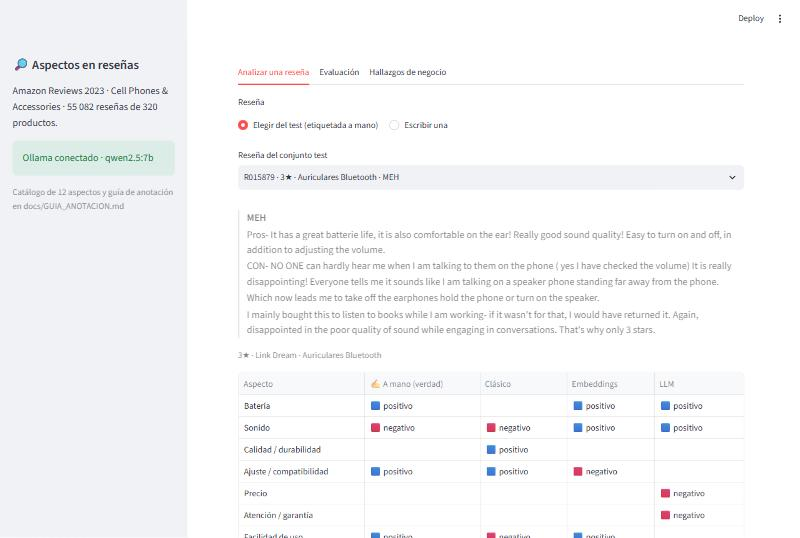
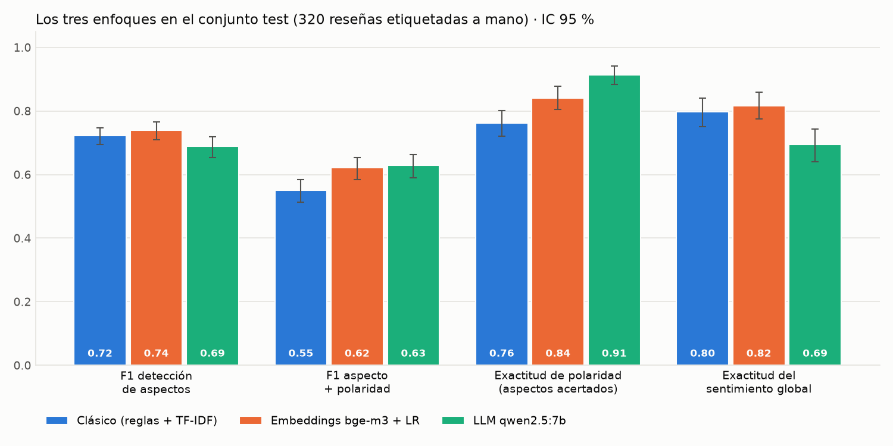
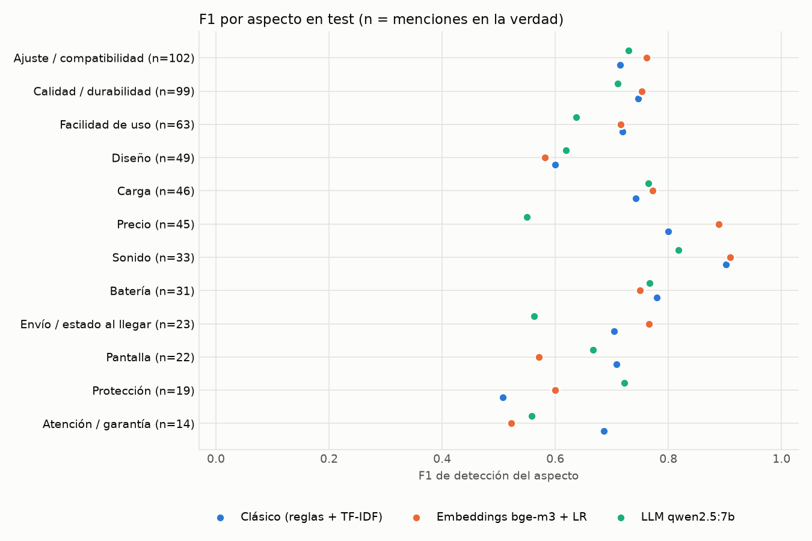
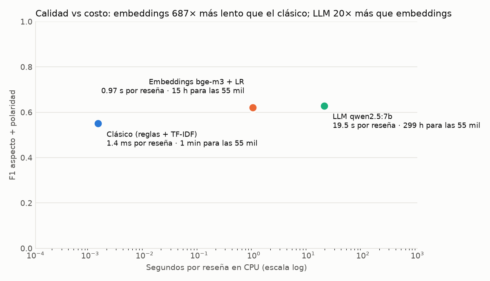
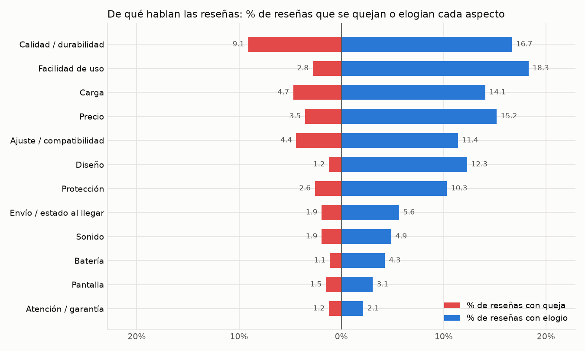
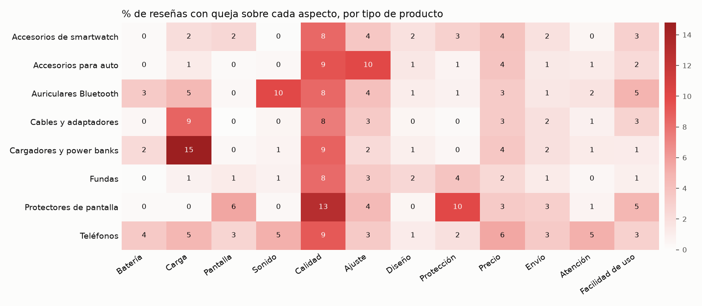
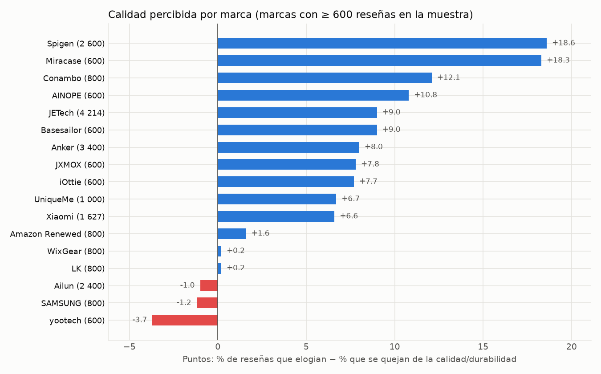
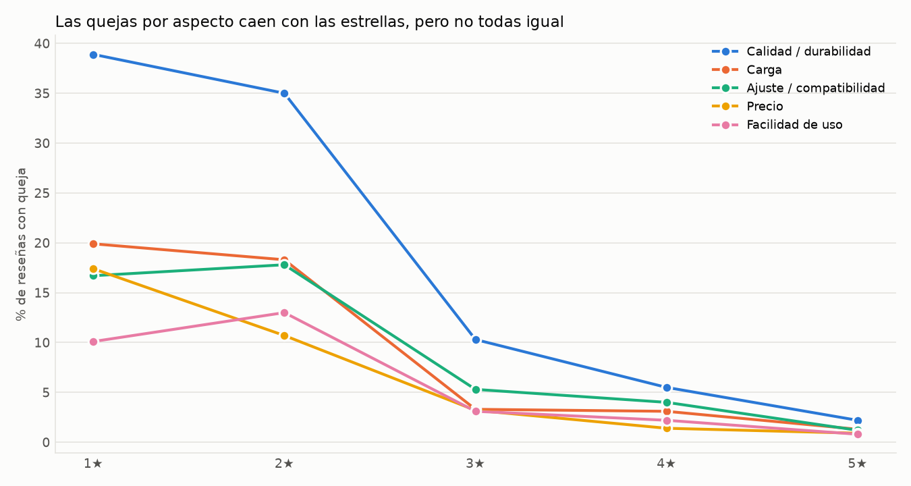
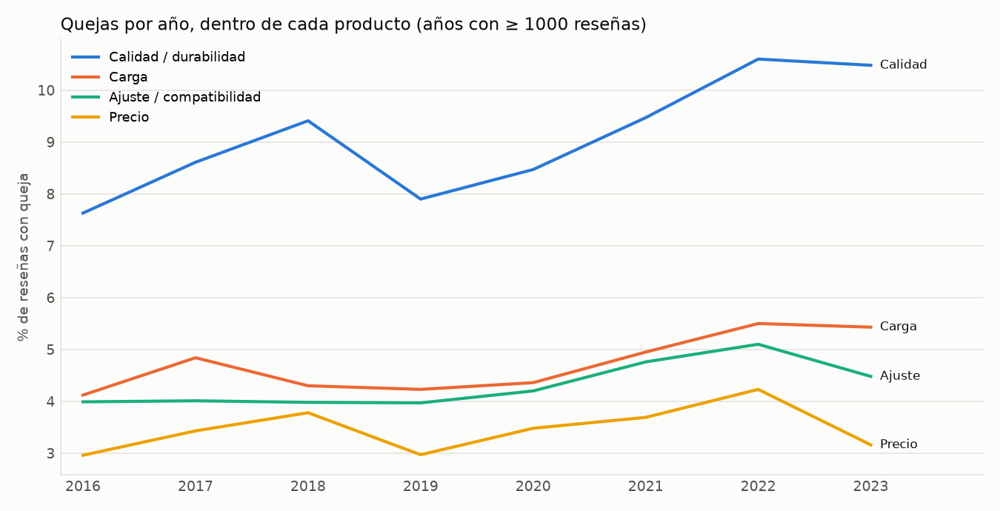
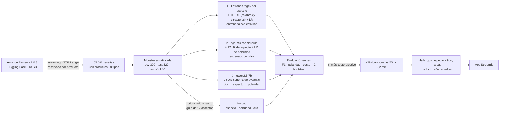

# 🔎 Sentimiento por aspecto en reseñas de Amazon: reglas vs embeddings vs LLM local

¿**De qué** se quejan los clientes de teléfonos y accesorios, y **cuánto les cuesta** a las marcas en estrellas?
Para cada reseña el sistema extrae los aspectos que menciona (batería, carga, pantalla, sonido, calidad, ajuste,
diseño, protección, precio, envío, atención, facilidad de uso) con su polaridad y la **cita textual** que lo
justifica. Se compararon **tres enfoques** contra **700 reseñas etiquetadas a mano** —incluidas 80 en español— y el
más costo-efectivo se aplicó a **55 082 reseñas** de 320 productos de Amazon Reviews 2023. Todo corre **local y
gratis** en un PC sin GPU.




---

## 🏆 Resultados (test: 320 reseñas etiquetadas a mano, 546 menciones de aspectos)

| Enfoque | F1 detección de aspectos | F1 aspecto + polaridad | Exactitud de polaridad ¹ | Exactitud sentimiento global | Costo por reseña (CPU) | 55 mil reseñas |
|---|---:|---:|---:|---:|---:|---:|
| **1 · Clásico**: diccionario de patrones + TF-IDF + regresión logística | 0,722 (0,70–0,75) | 0,550 (0,51–0,59) | 0,762 | 0,797 | **1,4 ms** | **~2 min** |
| **2 · Embeddings** `bge-m3` + regresiones logísticas | **0,739** (0,71–0,77) | 0,621 (0,58–0,65) | 0,841 | **0,816** | 0,97 s | ~15 h |
| **3 · LLM** `qwen2.5:7b`, salida estructurada pydantic | 0,688 (0,65–0,72) | **0,629** (0,59–0,66) | **0,914** | 0,694 | 19,5 s | ~12 días |

Entre paréntesis, IC 95 % por bootstrap de reseñas. ¹ Sobre los aspectos que el enfoque detectó bien: aísla la
polaridad de la detección.

| Parte en español (80 reseñas; **ningún enfoque se ajustó con español**) | F1 aspectos | Polaridad | Global |
|---|---:|---:|---:|
| Clásico (patrones en inglés + TF-IDF) | 0,50 (0,40–0,59) | 0,84 | 0,93 |
| Embeddings (bge-m3 es multilingüe; entrenado con dev en inglés) | **0,70** (0,63–0,77) | 0,91 | 0,91 |
| LLM | 0,69 (0,61–0,77) | **0,96** | 0,58 |

| Calidad de las etiquetas (2.ª pasada sobre 160 reseñas del test, otro orden, sin mirar la 1.ª) | |
|---|---:|
| F1 de aspectos entre pasadas | 0,96 |
| Kappa medio por aspecto (presente / ausente) | 0,96 (0,92–1,00) |
| Kappa de la polaridad de los aspectos comunes | 0,96 |
| Kappa del sentimiento global | 0,97 |

| | | |
|---|---|---|
|  |  |  |

### Qué enfoque y por qué

- **Ninguno domina.** En detección de aspectos los tres intervalos de confianza se solapan (embeddings 0,71–0,77,
  clásico 0,70–0,75, LLM 0,65–0,72): con 320 reseñas no se puede afirmar que uno detecte mejor que otro; el punto
  central más alto es el de los embeddings. El LLM acierta la polaridad (0,91) pero **detecta menos aspectos**
  (exhaustividad 0,68 vs 0,78) y es el peor en sentimiento global.
- **El clásico queda a 0,02 de F1 en detección (dentro del IC)** con un costo **690 veces menor** que los embeddings y
  ~14 000 veces menor que el LLM. Su punto débil es la polaridad (0,76): en los hallazgos se corrige con la
  precisión y exhaustividad medidas por aspecto en el test.
- **Por eso el clásico es el elegido** para las 55 082 reseñas (2,2 min). Correr el LLM tomaría ~12 días de CPU y no
  sería mejor en detectar de qué se habla.
- **En español** el clásico cae a 0,50 (sus patrones están en inglés) y los embeddings se mantienen en 0,70 sin un
  solo ejemplo en español: para un mercado hispano el enfoque 2 es la opción.

### 🔍 Qué aprendí de los errores

- **El LLM confunde "elogio genérico" con aspecto y viceversa.** Omite `precio` cuando la reseña dice "great price"
  (F1 0,55 en precio, contra 0,89 de los embeddings) y a veces inventa `calidad` en "works great". La guía lo
  define; un 7B no siempre la sigue.
- **El LLM dice "neutro" en reseñas positivas.** En 63 de 137 reseñas positivas del test respondió `neutro`
  (exactitud global 0,39 en las de 4★). La regla "neutro = mixto sin lado claro" la aplica a cualquier reseña con
  un "pero". En dev ya se veía (10 de 17) y no iteré el prompt para no volver a pagar 2 h de CPU: es la primera
  mejora pendiente.
- **Un prompt en inglés hizo que el LLM traduzca.** Pedí "cita literal, en inglés, sin traducir"; con reseñas en
  español el modelo tradujo la cita: 21 de 96 citas no son literales (vs 16 de 529 = 3 % en inglés). No afecta las
  métricas de aspectos, pero rompe la auditoría por cita.
- **El clásico es tan bueno como sus patrones.** En dev, afinar las reglas viendo los errores subió su F1 de 0,65 a
  0,76; en test quedó en 0,72 (lo esperable al pasar de datos vistos a no vistos). "Charge" aparece en casi todas
  las reseñas de cargadores aunque no se opine de la carga: el clásico sobredetecta `carga` (precisión 0,59 en test, exhaustividad 1,0).
- **300 ejemplos bastan para un clasificador sobre embeddings.** Con las citas de dev como etiquetas de cláusula
  (1 203 cláusulas, 557 con aspecto) más 3 000 reseñas con estrellas como supervisión débil, el enfoque 2 iguala al LLM
  en casi todo menos polaridad (con IC solapados en detección y mejor en sentimiento global), a 1/20 del costo.

## 📈 Hallazgos de negocio (55 082 reseñas, 2010–2023)



| Hallazgo | Cifra |
|---|---|
| Reseñas que opinan de al menos un aspecto / que tienen al menos una queja | **79 %** / **23 %** |
| Queja más frecuente: **calidad y durabilidad** ("se rompió", "dejó de funcionar", "se puso amarilla") | **9,6 %** de las reseñas (corregido) |
| Segunda: **ajuste y compatibilidad** (no encaja, se cae del soporte, no funciona con mi modelo) | 5,8 % corregido · el modelo la **subestima** (exhaustividad 0,63) |
| Tipo con más reseñas con queja / con menos | **Teléfonos 28,6 %** · Fundas 17,2 % |
| Cada tipo tiene "su" queja | cargadores → **carga 14,8 %** · auriculares → **sonido 10,0 %** · soportes para auto → **ajuste 10,0 %** · protectores → **calidad 12,9 % y protección 10,0 %** · teléfonos → **atención 5,1 %** (≥ 3× cualquier otro tipo) |
| Producto con más quejas (≥ 150 reseñas) | adaptador USB-C → Lightning de *zoyuzan*: **56 %** de reseñas con queja, 2,3★ |
| Marca con mejor y peor saldo de calidad (elogios − quejas, ≥ 600 reseñas) | **Spigen +18,6** puntos · **yootech −3,7** · Samsung −1,2 · Ailun −1,0 |
| Quejas de calidad **dentro de un mismo producto**, 2016 → 2022–2023 | **7,6 % → 10,5 %** (la tendencia no es solo un cambio en la mezcla de productos) |
| Estrellas asociadas a cada queja, con las 620 reseñas **etiquetadas a mano** | protección **−2,1★** · envío −1,8 · calidad −1,7 · atención −1,6 · precio −1,5 · ajuste −1,4; un elogio suma ≤ 0,5★ |

| | |
|---|---|
|  |  |
|  |  |

**Lectura para negocio.** Cada queja (salvo diseño) se asocia a 1–2 estrellas menos; un elogio suma como mucho media: en accesorios
baratos el cliente da por hecho que "funciona" y castiga cuando no. Lo que más hunde la calificación no es lo más
frecuente: los problemas de **protección** (el protector no salvó la pantalla) y de **envío** (llegó usado, roto o
incompleto) son raros pero cuestan casi 2 estrellas; el de **calidad** es frecuente *y* caro. Para un vendedor de
protectores y cargadores, durabilidad y compatibilidad son las dos palancas.

### Lectura honesta

- **Las cifras de negocio son detecciones de un modelo con F1 0,72**, no conteos exactos. Por eso la columna
  "corregido" usa precisión/exhaustividad del test por aspecto (solo con ≥ 10 menciones de soporte); la corrección
  es por aspecto, no específica de quejas.
- **La relación queja–estrellas del modelo es en parte circular**: su clasificador de polaridad aprendió de las
  estrellas. La versión que cito es la de las **620 reseñas etiquetadas sin ver las estrellas** (regresión
  ponderada para deshacer el muestreo estratificado); da el mismo orden y efectos mayores (el ruido del modelo los
  atenúa). Es asociación, no causalidad.
- **Acuerdo intra-anotador, no inter-anotador.** Etiqueté las dos pasadas yo: 0,96 mide consistencia con la guía,
  no si otra persona pondría lo mismo (en ABSA el acuerdo entre personas suele ser 0,7–0,8).
- **El test está estratificado por estrellas** (20 % de 1★ en vez de 12 %) y limitado a reseñas de 5–150 palabras
  (90 % del total), para tener quejas suficientes. Las métricas por estrella están en `reports/evaluacion.json`.
- **Muestra, no censo.** Los 40 productos más calificados de 8 tipos y hasta 200 reseñas por producto (muestreo de
  reservorio): el saldo de una marca refleja *esos* productos, no todo su catálogo.
- **Costo del LLM en CPU compartida.** 19,5 s por reseña (mediana 18 s, p90 33 s, 108 tokens de salida) en un
  Ryzen 5 4600G; con GPU sería ~10× más rápido y la conclusión de costo cambiaría de escala, no de orden.

## 🧠 Arquitectura



| Decisión | Por qué |
|---|---|
| **Etiquetar a mano 700 reseñas sin ver las estrellas** | Las estrellas no dicen qué aspecto se menciona ni su polaridad (una reseña de 5★ se queja del envío). Sin verdad independiente no se pueden comparar enfoques. |
| **dev para ajustar, test una sola vez** | Patrones, umbrales e hiperparámetros se eligieron en dev (validación cruzada de 5 particiones para los embeddings). El test no se miró hasta el final. |
| **Cláusulas, no oraciones** | "Love the color **but** it broke in a week" tiene dos aspectos con polaridad opuesta: se corta en "but/however/pero". |
| **Cita textual en la salida del LLM** | Permite auditar cada etiqueta y contar alucinaciones (3 % de citas no literales en inglés). La cita va **antes** del aspecto en el esquema: Ollama genera en ese orden y el modelo "lee" antes de decidir. |
| **Supervisión débil con estrellas** | 54 mil reseñas con estrellas entrenan el TF-IDF del clásico y 3 000 refuerzan la polaridad de los embeddings, sin etiquetar más. |
| **Streaming con reservorio** | Se leen 13 GB y se guardan 7 MB; el archivo está ordenado por usuario, así que tomar las primeras reseñas sesgaría la muestra. Reanudable con `Range` (se cortó una vez a los 1,04 GB y siguió). |
| **Todo grabado** | 440 respuestas del LLM y 6 364 embeddings versionados: las pruebas, la evaluación y la app corren sin Ollama. |
| **Sin texto crudo en el repo** | Amazon Reviews 2023 es de uso en investigación: se versionan ids, huellas SHA-1 y etiquetas, y `python -m resenas.muestra` reconstruye el texto desde la descarga comprobando cada huella. |
| **Regresión con todas las quejas a la vez** | Una reseña con queja de calidad suele tener otras; el coeficiente aísla cada una. Errores robustos (HC1). |
| **Tendencia intra-producto** | Se resta la tasa de cada producto antes de promediar por año: separa "los productos empeoraron" de "se vendían otros productos". |

## 🚀 Cómo ejecutarlo

Guía completa para Windows y preguntas de entrevista: **[docs/GUIA_PASO_A_PASO.md](docs/GUIA_PASO_A_PASO.md)** ·
guía de anotación: **[docs/GUIA_ANOTACION.md](docs/GUIA_ANOTACION.md)**

```bash
pip install -r requirements.txt && pip install -e .
pytest                                           # 42 pruebas + 4 que se activan con la descarga; sin Ollama ni red
python descargar_datos.py                        # 13 GB en streaming → 7 MB (~10 min, reanudable)
python -m resenas.muestra                        # reconstruye el texto de las 700 reseñas etiquetadas (verifica huellas)
python -m resenas.evaluar                        # 3 enfoques en test y español (usa lo grabado; requiere la descarga)
python -m resenas.aplicar                        # clásico sobre las 55 mil reseñas (~2 min)
python -m resenas.hallazgos                      # tablas y figuras de negocio
streamlit run app/streamlit_app.py               # comparar enfoques, evaluación, hallazgos
RESENAS_GRABAR=1 python -m resenas.correr_llm    # volver a correr el LLM (~2,5 h en CPU, reanudable)
```

**Sin Ollama:** `RESENAS_PROVEEDOR=grabado streamlit run app/streamlit_app.py`. Sin la descarga la app funciona, pero no
muestra el texto de las reseñas del test (solo sus citas etiquetadas y las predicciones). En Windows, todo en un comando:
`powershell -ExecutionPolicy Bypass -File .\evaluar_en_mi_pc.ps1`.

## 📁 Estructura

```
├── src/resenas/
│   ├── descarga.py           streaming HTTP con Range, reservorio por producto, punto de control
│   ├── preparar.py           une reseñas y productos; sortea dev/test y el conjunto en español
│   ├── muestra.py            índice de las 700 reseñas (ids + huellas) y reconstrucción verificada de su texto
│   ├── texto.py              cláusulas, citas literales, detector de español
│   ├── esquema.py            pydantic: verdad = salida del LLM; JSON Schema para Ollama
│   ├── etiquetas.py          formato compacto de etiquetado → JSONL validado
│   ├── enfoque_clasico.py    patrones por aspecto + TF-IDF + regresión logística
│   ├── enfoque_embeddings.py caché bge-m3, cláusula ↔ cita, clasificadores
│   ├── enfoque_llm.py · llm.py   prompt, salida estructurada, modo grabado
│   ├── correr_llm.py         corrida reanudable del LLM
│   ├── metricas.py           F1, polaridad, bootstrap, kappa
│   ├── evaluar.py            dev → test → español, costos, figuras 01-03
│   ├── aplicar.py · hallazgos.py   55 mil reseñas → tablas y figuras 04-08
│   └── graficos.py
├── app/streamlit_app.py
├── data/etiquetas/           etiquetas: dev 300 · test 320 · 2.ª pasada 160 · español 80 (.txt y .jsonl) + indice_muestra.jsonl
├── data/grabacion_llm.jsonl  440 respuestas del LLM · data/embeddings_etiquetadas.npz (6 364 vectores)
├── data/modelo_*.joblib      modelos entrenados (clásico 8 MB, embeddings 80 KB)
├── notebooks/                01 exploración · 02 evaluación · 03 hallazgos (ejecutados)
├── reports/                  evaluacion.json, predicciones, hallazgos/*.csv, figuras, capturas
├── tests/                    46 pruebas (LLM simulado o grabado); datos/ = 8 reseñas de prueba (ver LEEME.md)
└── descargar_datos.py · evaluar_en_mi_pc.ps1
```

## 📚 Fuentes y licencia

- **Datos:** [Amazon Reviews 2023](https://amazon-reviews-2023.github.io/) (McAuley Lab, UC San Diego) en
  [Hugging Face](https://huggingface.co/datasets/McAuley-Lab/Amazon-Reviews-2023), categoría *Cell Phones and
  Accessories*. Hou et al., *Bridging Language and Items for Retrieval and Recommendation*, arXiv:2403.03952 (2024).
  **Licencia de los datos: uso académico y de investigación** (no es MIT). Por eso el repositorio **no versiona el
  texto de las reseñas**: `descargar_datos.py` lo baja de la fuente y `python -m resenas.muestra` reconstruye el de las
  700 etiquetadas, comprobando cada una con su huella SHA-1. Lo que sí se versiona es derivado de ese trabajo: ids,
  metadatos del producto (tipo, marca, estrellas), las etiquetas con sus **citas** (fragmentos breves), las
  respuestas del LLM, los vectores de embeddings, los modelos entrenados y tablas agregadas. Además, `tests/datos/`
  incluye **8 reseñas** completas solo como fixture de prueba y con atribución (ver `tests/datos/LEEME.md`).
- **Español:** el conjunto público `amazon_reviews_multi` (que traía reseñas en español) fue retirado de Hugging Face
  por Amazon en 2023 (hoy en `defunct-datasets`). En su lugar se usaron las ~1 360 reseñas que clientes
  hispanohablantes escribieron en español en Amazon EE. UU. dentro del mismo subconjunto (2,5 %; 13 % en teléfonos).
- **Modelos:** [Qwen2.5-7B-Instruct](https://ollama.com/library/qwen2.5) (Apache 2.0) y
  [BGE-M3](https://ollama.com/library/bge-m3) (MIT), vía Ollama.
- **Código:** MIT (ver `LICENSE`). Los datos siguen la licencia de su fuente, como se indica arriba.

---

**Erick Guarnizo** · proyecto de portafolio (IA)
