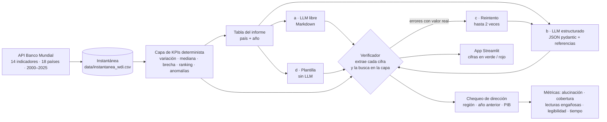
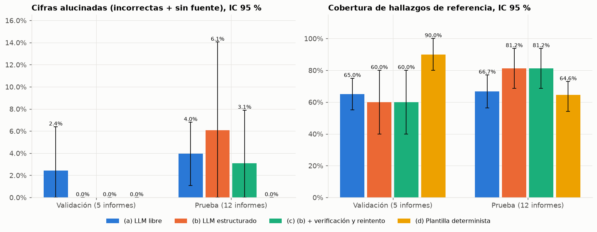
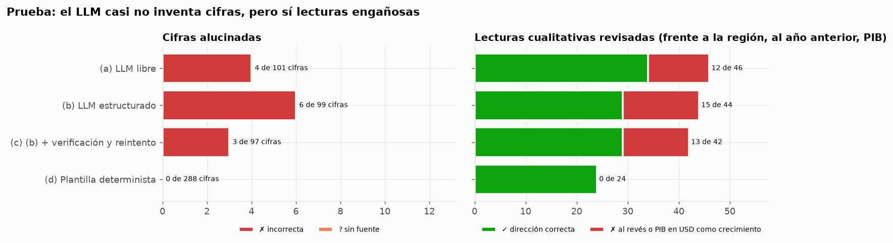
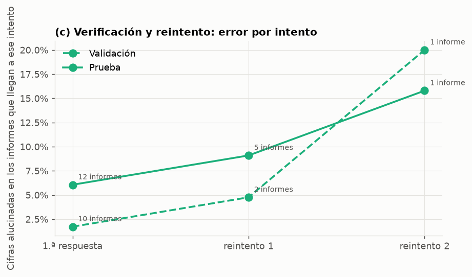
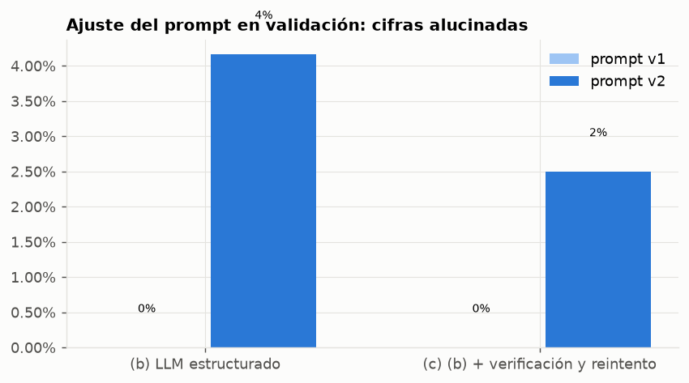
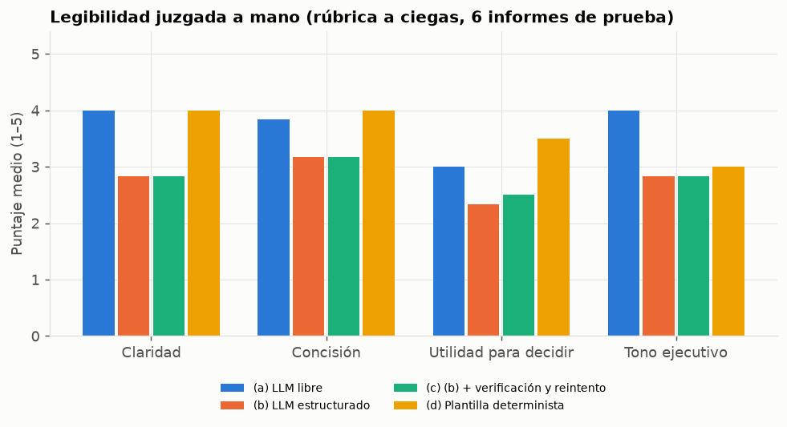
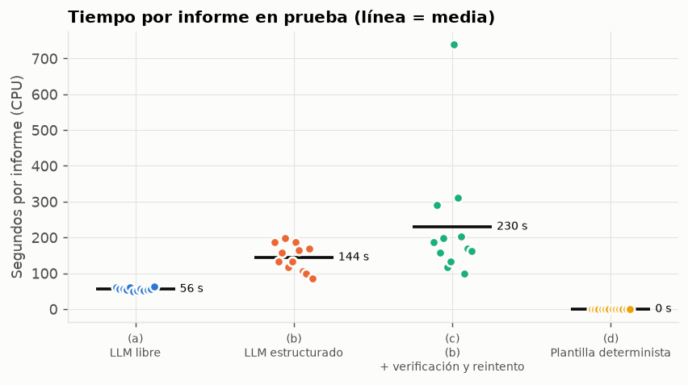
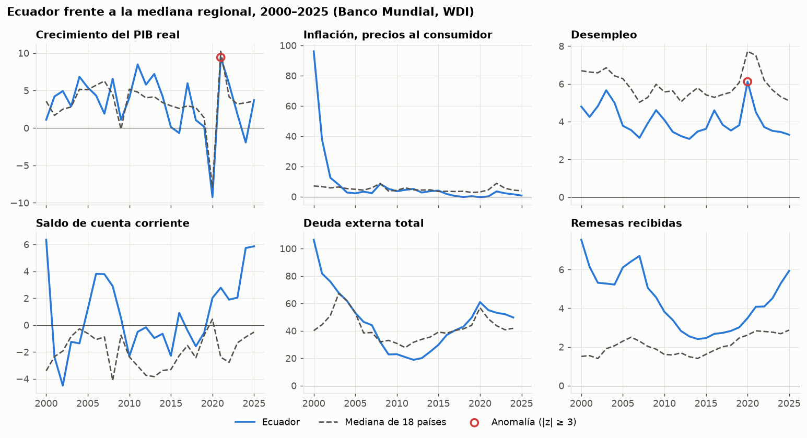
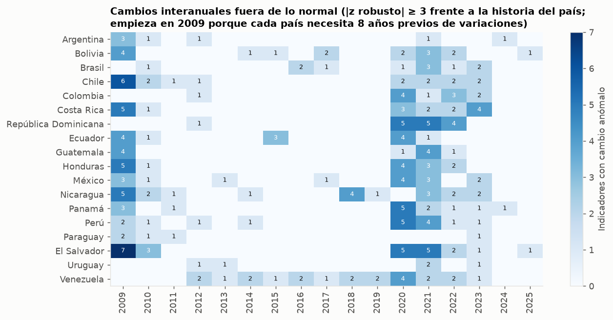

# 📊 Resúmenes ejecutivos de KPIs con verificación de cada cifra

Un LLM local (`qwen2.5:7b` en Ollama, CPU) redacta para gerencia el resumen económico de un país de América Latina a partir de los indicadores del Banco Mundial, y un **verificador automático comprueba cada número del texto** contra una capa de KPIs determinista: correcta, incorrecta (con el valor real) o sin fuente. Se comparan cuatro enfoques en un conjunto de **validación** (5 informes de 2023, usado para ajustar el prompt) y uno de **prueba** (12 informes de 2024 de otros países, corrido una sola vez).


---

## 📌 Resumen en cifras (prueba: 12 informes de 2024)

| Enfoque | Cifras (por informe) | Alucinadas (IC 95 %) | Incorrectas | Sin fuente | Informes sin ningún error | Cobertura de hallazgos (IC 95 %) | Lecturas engañosas detectadas | Llamadas al LLM | Tiempo por informe |
|---|---:|---:|---:|---:|---:|---:|---:|---:|---:|
| (a) LLM libre | 101 (8,4) | 4,0 % (1,1–6,8 %) | 4 | 0 | 66,7 % | 66,7 % (56,2–77,1 %) | 12 de 46 revisadas | 1,00 | 56 s |
| (b) LLM estructurado | 99 (8,2) | 6,1 % (0,0–14,1 %) | 6 | 0 | 83,3 % | 81,2 % (68,8–93,8 %) | 15 de 44 revisadas | 1,00 | 144 s |
| **(c) (b) + verificación y reintento** | 97 (8,1) | 3,1 % (0,0–7,9 %) | 3 | 0 | 91,7 % | 81,2 % (68,8–93,8 %) | 13 de 42 revisadas | 1,50 | 230 s |
| (d) Plantilla determinista | 288 (24,0) | 0,0 % (0,0–0,0 %) | 0 | 0 | 100,0 % | 64,6 % (54,2–72,9 %) | 0 de 24 revisadas | 0,00 | < 1 s |

IC 95 %: bootstrap por informe (2.000 remuestreos de informes completos). «Alucinadas» = incorrectas + sin fuente, sobre todas las cifras que el verificador extrae del texto. «Lecturas engañosas» = comparaciones con la región o con el año anterior escritas al revés, o la variación del PIB en dólares presentada como crecimiento; las detecta un chequeo aparte (`src/kpis/comparaciones.py`). Prompt elegido en validación: `v1`.

**Lo que muestran los resultados**

1. **El LLM casi no inventa cifras cuando tiene la tabla delante.** En prueba alucina el 4,0 % de las cifras en texto libre, el 6,1 % con salida estructurada y el 3,1 % con verificación y reintento. Con 12 informes, estas diferencias **no son significativas** (los IC se solapan; (c) − (b) = -3,0 pp, IC -6,9 pp a 0,0 pp).
2. **El problema real son las lecturas engañosas con cifras correctas.** Entre el 26,1 % (texto libre) y el 34,1 % (estructurado) de las lecturas cualitativas que se pueden revisar están mal: «la inflación (4,6 %) se mantuvo por debajo de la mediana (4,3 %)» o «el PIB de Ecuador creció 2,5 %» cuando el PIB real cayó 1,9 % (el 2,5 % es la variación en dólares corrientes). El verificador de cifras las da por buenas porque cada número existe.
3. **La salida estructurada mejora la cobertura**: 81,2 % de los hallazgos imprescindibles frente a 66,7 % en texto libre (+14,6 pp, IC 6,2 pp a 25,0 pp): es la única ventaja significativa de la estructura, probablemente porque cada afirmación tiene que citar su indicador.
4. **Verificar y reintentar** sube los informes sin ningún error de 83,3 % a 91,7 %, a cambio de 1,50 llamadas por informe y 230 s en vez de 144 s. Un informe (Honduras) sigue fallando tras dos reintentos.
5. **La plantilla determinista no se equivoca nunca** (288 cifras, 0 errores, 0 lecturas engañosas, < 1 s) y se lee casi tan bien como el texto libre (3,62 frente a 3,71 de 5), pero cubre menos hallazgos (64,6 %): elige con reglas fijas y no con criterio.

**Recomendación**: para un informe que va a gerencia, la plantilla da la base fiable; el LLM aporta cuando redacta sobre hechos ya seleccionados y cuando su texto pasa por **ambos** chequeos (cifras y dirección de las comparaciones), con los errores devueltos al reintento.

---

## 🧭 Cómo funciona



| Pieza | Archivo |
|---|---|
| Descarga con caché e instantánea | `src/kpis/descargar.py` |
| Capa de KPIs (fuente de verdad) | `src/kpis/capa_kpis.py` |
| Extractor de cifras en español | `src/kpis/numeros.py` |
| Verificador de cifras | `src/kpis/verificador.py` |
| Chequeo de dirección de las comparaciones | `src/kpis/comparaciones.py` |
| Esquema pydantic del informe | `src/kpis/esquema.py` |
| Los 4 enfoques y los prompts | `src/kpis/generadores.py` |
| Cliente Ollama con grabación y reintentos de red | `src/kpis/llm.py` |
| Evaluación, IC, figuras y este README | `src/kpis/evaluacion.py`, `ejecutar_evaluacion.py`, `graficos.py`, `informe.py` |
| App y API | `app/app_streamlit.py`, `api/main.py` |

---

## 🏆 Resultados

### 1. Los cuatro enfoques en prueba



| Comparación (prueba, mismos 12 informes) | Métrica | Diferencia | IC 95 % |
|---|---|---:|---:|
| (c) (b) + verificación y reintento − (b) LLM estructurado | Cifras alucinadas | -3,0 pp | -6,9 a 0,0 pp |
| (c) (b) + verificación y reintento − (b) LLM estructurado | Cobertura | 0,0 pp | 0,0 a 0,0 pp |
| (b) LLM estructurado − (a) LLM libre | Cifras alucinadas | 2,1 pp | -5,1 a 10,9 pp |
| (b) LLM estructurado − (a) LLM libre | Cobertura | 14,6 pp | 6,2 a 25,0 pp |
| (c) (b) + verificación y reintento − (a) LLM libre | Cifras alucinadas | -0,9 pp | -6,3 a 5,1 pp |
| (c) (b) + verificación y reintento − (a) LLM libre | Cobertura | 14,6 pp | 6,2 a 25,0 pp |
| (d) Plantilla determinista − (c) (b) + verificación y reintento | Cifras alucinadas | -3,1 pp | -8,0 a 0,0 pp |
| (d) Plantilla determinista − (c) (b) + verificación y reintento | Cobertura | -16,7 pp | -29,2 a -4,2 pp |

- Las cifras alucinadas son pocas y de tres tipos: puestos de ranking inventados («mejorando su posición de 13 a 12», cuando el puesto del año anterior no está en la tabla), puestos equivocados («el primer puesto en remesas», era el segundo) y cálculos propios (un «déficit comercial de 4,1 %» que el LLM obtuvo restando exportaciones e importaciones). Ninguna es un valor de indicador inventado.
- Las referencias del JSON son menos fiables que el texto: solo el 77,9 % de las referencias de (b) coincide con la capa (el modelo escribe «4,7 %» como `47` o pone la mediana con el código del país), y además pega en promedio 3,2 tuplas técnicas por informe dentro del texto, como «(desempleo, MEX, 2024, valor, 27)».



Lecturas engañosas en prueba por tipo:

| Enfoque | Frente a la región, al revés | Frente al año anterior, al revés | PIB en USD presentado como crecimiento |
|---|---:|---:|---:|
| (a) LLM libre | 4 | 3 | 5 |
| (b) LLM estructurado | 8 | 2 | 5 |
| (c) (b) + verificación y reintento | 7 | 2 | 4 |
| (d) Plantilla determinista | 0 | 0 | 0 |

La confusión del PIB es la más grave para un gerente: la tabla trae la variación del PIB en dólares corrientes y el crecimiento real, y el modelo titula con la primera («El PIB de Colombia creció 14,6 %») aunque la economía creció 1,5 %.

### 2. Verificación y reintento



En prueba reintentaron 5 de 12 informes (por cifras con error o por referencias que no existen en la tabla). Pasaron sin error 10 informes en el primer intento y 11 al final. La curva sube porque solo los informes difíciles llegan a otro intento: en Honduras el modelo corrigió una cifra y en el reintento cambió el desempleo de 2024 (4,9 %) por el de 2023 (6,1 %), que el verificador acepta porque existe para el año anterior. Corregir con un LLM puede introducir errores nuevos.

### 3. Ajuste del prompt en validación

| Enfoque · prompt | Cifras (por informe) | Alucinadas (IC 95 %) | Correctas por informe | Referencias JSON correctas | Referencias pegadas en el texto (por informe) | Cobertura |
|---|---:|---:|---:|---:|---:|---:|
| (b) LLM estructurado · `v1` | 34 (6,8) | 0,0 % (0,0–0,0 %) | 6,8 | 88,5 % | 3,0 | 60,0 % |
| (b) LLM estructurado · `v2` | 24 (4,8) | 4,2 % (0,0–15,0 %) | 4,6 | 97,3 % | 0,0 | 80,0 % |
| (c) (b) + verificación y reintento · `v1` | 34 (6,8) | 0,0 % (0,0–0,0 %) | 6,8 | 88,5 % | 3,0 | 60,0 % |
| (c) (b) + verificación y reintento · `v2` | 40 (8,0) | 2,5 % (0,0–10,3 %) | 7,8 | 97,1 % | 0,0 | 75,0 % |
| (a) LLM libre · `v1` | 41 (8,2) | 2,4 % (0,0–6,4 %) | 8,0 | — | 0,0 | 65,0 % |
| (d) Plantilla determinista | 120 (24,0) | 0,0 % (0,0–0,0 %) | 24,0 | 100,0 % | 0,0 | 90,0 % |

- `v2` añade reglas explícitas (copiar cifras tal cual, pp para variaciones de tasas, no calcular, no inventar metas, formato JSON de las referencias). Resultado inesperado: el modelo se volvió **más callado**: escribió 4,8 cifras por informe frente a 6,8, y en Argentina no puso ninguna. Un informe sin cifras tiene 0 % de alucinación, así que la regla de elección se completó en validación: una versión solo es elegible si promedia al menos 4 cifras correctas por informe. Con esa regla o sin ella gana `v1` (0,0 % frente a 4,2 %).
- `v2` sí resolvía dos problemas de `v1` que se ven en prueba: las referencias mal escritas y las tuplas pegadas en el texto. Es el intercambio que queda abierto (ver Limitaciones).



### 4. Legibilidad (juzgada a mano, a ciegas)

Rúbrica de 1 a 5 en cuatro criterios, en 6 informes de prueba × 4 enfoques, con los textos barajados y sin saber qué enfoque produjo cada uno (`data/rubrica_textos.md`, `data/rubrica_legibilidad.csv`). La rúbrica está en `docs/GUIA_PASO_A_PASO.md`.

| Enfoque | Claridad | Concisión | Utilidad para decidir | Tono ejecutivo | **Media** |
|---|---:|---:|---:|---:|---:|
| (a) LLM libre | 4,00 | 3,83 | 3,00 | 4,00 | **3,71** |
| (b) LLM estructurado | 2,83 | 3,17 | 2,33 | 2,83 | **2,79** |
| (c) (b) + verificación y reintento | 2,83 | 3,17 | 2,50 | 2,83 | **2,83** |
| (d) Plantilla determinista | 4,00 | 4,00 | 3,50 | 3,00 | **3,62** |

El texto libre es el que mejor se lee; la salida estructurada pierde por las tuplas técnicas pegadas y por contradicciones («el PIB se contrajo» y «el crecimiento se aceleró» en el mismo informe de Brasil). La plantilla puntúa alto en claridad y utilidad, pero suena a tabla puesta en frases.



### 5. ¿Se puede confiar en el verificador? Auditoría manual

Revisé a mano las 13 cifras de prueba que el verificador marcó como incorrectas o sin fuente y una muestra aleatoria de 40 que marcó como correctas (`data/auditoria_verificador.csv`).

| Verificador \ revisión a mano | correcta | incorrecta | sin_fuente |
|---|---:|---:|---:|
| correcta | 38 | 1 | 1 |
| incorrecta | 3 | 6 | 4 |

- De las marcadas como malas, 10 lo eran (76,9 %). Las 3 restantes son totales de países («entre los 18 países») o un puesto escrito sin la palabra «puesto» («puesto 14 y 15»): el verificador **sobrestima** un poco la alucinación.
- De las marcadas como correctas, 38 lo eran (95,0 %). Los dos fallos son un «7» de ranking que coincidió por azar con una inflación de 6,7 % y un «disminuyó a 6,1 %» que es el dato del año anterior.
- 8 de las 40 cifras correctas de la muestra están en una frase engañosa: la cifra está bien y la conclusión no.

### 6. Tiempo por informe



CPU de escritorio (Ryzen 5 4600G, sin GPU). La salida estructurada tarda más que el texto libre porque el JSON con referencias tiene más tokens; el reintento añade una o dos llamadas en los informes con errores. Las corridas de validación compartieron la CPU con otros contenedores, así que sus tiempos son más altos.

### 7. La capa de KPIs: Ecuador frente a la región



En 2024 Ecuador tuvo la peor contracción de las 18 economías (−1,9 %, puesto 18; también cayeron Argentina y Bolivia), con el mayor superávit de cuenta corriente de la región (5,7 % del PIB) y una pobreza extrema que subió 2,6 pp, hasta 7,3 %, la tercera más alta.



El detector de anomalías marca solo con la historia previa de cada país; los picos de 2009 (crisis financiera) y 2020–2021 (pandemia y rebote) aparecen sin que nadie se los indique.

---

## 🛠️ Decisiones de diseño

1. **Separar calcular de redactar.** Todas las cifras citables salen de la capa de KPIs (variación, mediana regional, brecha, ranking, anomalía). El LLM solo recibe esa tabla y redacta; el verificador comprueba contra la misma capa. Así la «verdad» no depende del modelo.
2. **Variaciones en pp para tasas y en % para niveles.** La confusión entre puntos porcentuales y porcentaje es el error de unidades típico; el verificador lo acepta solo si el número coincide y lo marca (`pp_escrito_como_%`).
3. **Tolerancia por redondeo, no un porcentaje fijo.** «3,5 %» acepta de 3,45 a 3,55; «123,8 mil millones» acepta ±0,05 mil millones. Un margen fijo del 5 % dejaría pasar errores en cifras grandes.
4. **Cifras ambiguas con varios candidatos.** «5,503 USD» puede ser 5,503 o 5.503; «billones» puede ser 10¹² o el anglicismo 10⁹. El extractor devuelve las dos lecturas, cada una con su propia tolerancia.
5. **Contexto antes que búsqueda global.** Un número se compara primero con su referencia estructurada y luego con el indicador, país y año de su oración. Solo si la oración no nombra ningún indicador se busca en toda la tabla, y solo para cifras con decimales o escala: «3» coincide por azar con demasiadas cosas.
6. **Anomalías sin mirar el futuro.** z robusto (mediana y MAD) de la variación frente a los años anteriores del mismo país, con un piso de escala (0,5 pp o 2 %) para que la población, que cambia en décimas, no salga anómala todos los años.
7. **Validación y prueba sin solapamiento.** Validación: 5 países en 2023. Prueba: otros 12 países en 2024, Ecuador incluido. Los prompts se ajustaron solo con validación; la prueba se corrió una vez.
8. **Bootstrap por informe.** Las cifras de un mismo informe no son independientes; remuestrear cifras sueltas daría IC demasiado estrechos.
9. **Todo grabado.** Cada respuesta de Ollama se guarda con una huella de (modelo, mensajes, esquema, opciones). La evaluación, las pruebas, la app y la API corren sin Ollama, y una corrida cortada se retoma sin repetir llamadas.
10. **Errores encontrados por el camino.** Revisando salidas reales se corrigieron cuatro fallos del extractor: ordinales con «ª/º» («18ª posición»), tuplas de referencia pegadas en el texto, cifras que son parte del nombre del indicador («USD 3,00 al día», «PPA 2021», «0–100») y la coma inglesa de miles («5,503 USD»). Este último apareció al revisar las salidas de **prueba**, así que esa corrección sí vio datos de prueba; los demás falsos positivos de la auditoría se dejaron como están.

---

## ⚠️ Limitaciones

- **Cifra correcta no es frase correcta.** El verificador comprueba que el número exista para ese indicador, no lo que la frase concluye. El LLM escribe «el PIB creció 2,5 %» con la variación en dólares corrientes cuando el PIB real cayó, o «por debajo de la mediana» cuando está por encima. El chequeo de dirección (`comparaciones.py`) detecta tres patrones, es conservador (no opina si no identifica un indicador) y **no** alimenta los reintentos de (c); hacerlo es el siguiente paso natural.
- **Muestra pequeña.** 12 informes de prueba y unas 100 cifras por enfoque: los IC de la tasa de alucinación se solapan y no permiten ordenar los enfoques de LLM entre sí.
- **Cobertura con palabras clave.** Un hallazgo de referencia cuenta como cubierto si se nombra su indicador, aunque la frase lo cuente mal. La lista de referencia la armé yo a partir de la misma capa de KPIs que usa la plantilla, lo que puede favorecer a (d) en validación.
- **Rúbrica de un solo evaluador.** La legibilidad la puntué yo, a ciegas en cuanto a los ids, pero el estilo de la plantilla es reconocible. Con un solo juez no hay acuerdo entre evaluadores.
- **El verificador acepta el año anterior.** Si la oración no nombra el año, se aceptan cifras del año del informe y del anterior; así pasó «disminuyó a 6,1 %» (dato de 2023).
- **Datos.** La deuda externa de WDI no cubre a los países de ingreso alto (Chile, Uruguay, Panamá, Costa Rica), y pobreza y Gini no se publican todos los años; la tabla usa el último dato de hasta 3 años antes y lo indica. Venezuela queda fuera de los informes evaluados.
- **Un solo modelo y temperatura 0.** Los resultados son de `qwen2.5:7b` cuantizado en CPU; otro modelo puede tener otro perfil de errores.

---

## ▶️ Cómo reproducir

```bash
python -m venv .venv
.venv/Scripts/python -m pip install -r requirements.txt -e .     # en Linux/Mac: .venv/bin/python
.venv/Scripts/python -m pytest -q -p no:cacheprovider          # sin red y sin Ollama
.venv/Scripts/python -m kpis.ejecutar_evaluacion               # regenera reports/ desde lo grabado
.venv/Scripts/python -m kpis.informe                           # regenera este README y la guía
streamlit run app/app_streamlit.py                             # app
uvicorn api.main:app                                           # API opcional (/kpis, /verificar, /informe)
```

Para volver a pedir los datos: `python -m kpis.descargar --forzar`. Para volver a llamar al LLM: `ollama serve`, `ollama pull qwen2.5:7b` y luego `KPIS_PROVEEDOR=ollama python -m kpis.correr_llm validacion`, `validacion_c` y `prueba` (reanudable: lo grabado en `data/grabacion_llm.jsonl` no se repite). Los notebooks de `notebooks/` están ejecutados y leen `reports/`.

```
├── src/kpis/          capa de KPIs, extractor, verificador, comparaciones, generadores, evaluación
├── app/  api/         Streamlit y FastAPI
├── data/              instantánea WDI, grabaciones del LLM, referencia de hallazgos, revisión manual
├── reports/           resultados.json, CSV de detalle, informes generados y figuras
├── notebooks/         01 datos y KPIs · 02 extractor y verificador · 03 evaluación
├── scripts/           notebooks, revisión manual y plantillas de README y guía
└── tests/             pytest (KPIs, extractor, verificador, comparaciones, API, README contra reports/)
```

---

## 📚 Fuente y licencia

- **Datos**: Banco Mundial, *World Development Indicators*, API v2 (descarga del 2026-10-27), licencia **CC BY 4.0**. Indicadores: PIB y PIB per cápita (USD corrientes), crecimiento del PIB real, inflación, desempleo (OIT), exportaciones e importaciones, cuenta corriente, IED, remesas (% del PIB), deuda externa (% del INB), pobreza extrema (USD 3,00 al día, PPA 2021), Gini y población.
- **Código**: licencia MIT (ver `LICENSE`).
- **Modelo**: `qwen2.5:7b` (Qwen, licencia Apache 2.0) servido localmente con Ollama.
